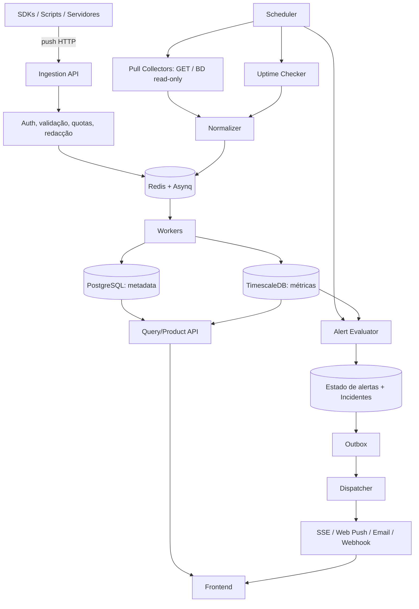
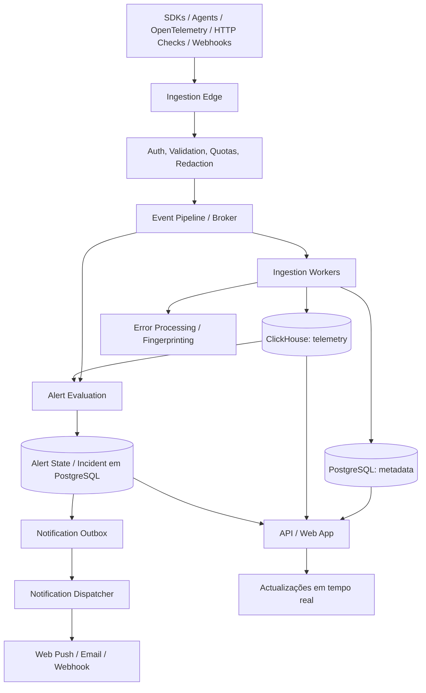
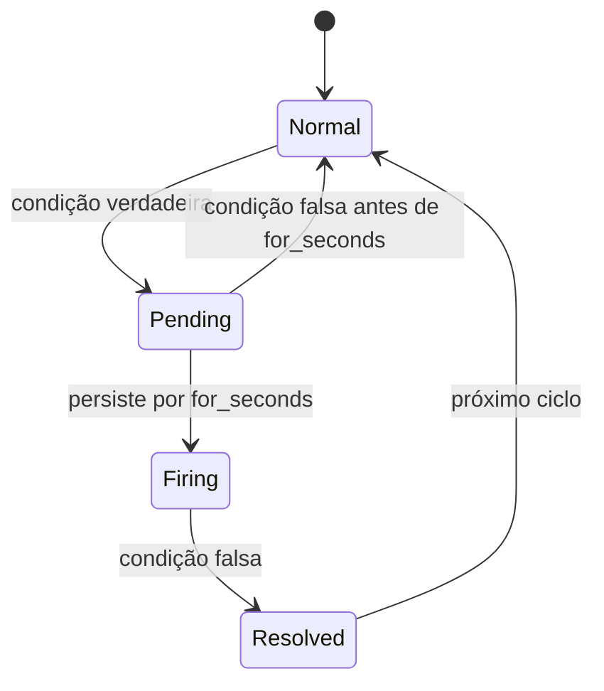

# Vigia

> Plataforma unificada de **monitoramento, alertas em tempo real, auditoria e error tracking**.
> Une o essencial de **Sentry** (erros), **Grafana** (métricas/dashboards) e **Gotify** (notificações push) num único servidor leve, seguro e escalável.

**Estado:** documento de arquitectura e plano de construção (proposta para V1). **O código actual é a fundação do backend em Go (configuração, servidor HTTP endurecido, BD, Redis, migrations, CI) e o ambiente Docker de desenvolvimento**; a plataforma descrita aqui ainda não está implementada. Ver [secção 26](#26-estado-actual-e-configuração-local).
**Nome:** provisório
**Idioma do código/API:** inglês · **Idioma da documentação:** português

**Objectivo deste documento:** servir de referência técnica, checklist de implementação e guia de decisões durante a construção da plataforma. Descreve uma arquitectura-alvo pragmática; as decisões devem ser validadas com protótipos, medições, requisitos e revisões de segurança.

---

## Índice

1. [Visão e objectivos](#1-visão-e-objectivos)
2. [Princípios de engenharia](#2-princípios-de-engenharia)
3. [Escopo](#3-escopo)
4. [Arquitectura](#4-arquitectura)
5. [Stack tecnológica](#5-stack-tecnológica)
6. [Estrutura do repositório](#6-estrutura-do-repositório)
7. [Módulos e regras de negócio](#7-módulos-e-regras-de-negócio)
8. [Modelo de dados](#8-modelo-de-dados)
9. [API](#9-api)
10. [Autenticação, autorização e tokens](#10-autenticação-autorização-e-tokens)
11. [Segurança](#11-segurança)
12. [Integrações e APIs externas](#12-integrações-e-apis-externas)
13. [Escalabilidade e performance](#13-escalabilidade-e-performance)
14. [Auto-observabilidade, SLOs e runbooks](#14-auto-observabilidade-slos-e-runbooks)
15. [QA e estratégia de testes](#15-qa-e-estratégia-de-testes)
16. [DevOps, CI/CD e deploy](#16-devops-cicd-e-deploy)
17. [Retenção, privacidade e quotas](#17-retenção-privacidade-e-quotas)
18. [Frontend](#18-frontend)
19. [SDKs](#19-sdks)
20. [Roadmap por fases](#20-roadmap-por-fases)
21. [Definition of Done](#21-definition-of-done)
22. [Checklist de produção](#22-checklist-de-produção)
23. [Riscos e mitigação](#23-riscos-e-mitigação)
24. [Decisões em aberto (ADRs)](#24-decisões-em-aberto-adrs)
25. [Lacunas conhecidas da documentação](#25-lacunas-conhecidas-da-documentação)
26. [Estado actual e configuração local](#26-estado-actual-e-configuração-local)
27. [Glossário](#27-glossário)
28. [Referências](#28-referências)

---

## 1. Visão e objectivos

### 1.1 Visão

Construir uma plataforma unificada de observabilidade e resposta a incidentes que combine as capacidades essenciais de:

- **Observabilidade:** métricas, dashboards, monitorização de disponibilidade e exploração de dados.
- **Error tracking:** captura, agrupamento, contexto técnico, releases e investigação de erros.
- **Alerting e notificações:** regras, incidentes, deduplicação, políticas de notificação e entrega em vários canais.
- **Logs e traces:** ingestão, pesquisa e correlação, evoluindo por fases.
- **Gestão operacional:** projectos, ambientes, equipas, incidentes, auditoria, quotas e retenção.

### 1.2 Perguntas operacionais a que responde

Com menos fricção e mais contexto:

1. O serviço está saudável?
2. O que falhou e quando começou?
3. Qual o impacto (serviços/ambientes afectados)?
4. Há relação com um deploy, métrica, log ou erro?
5. Quem está a tratar?
6. Foi reconhecido e resolvido?
7. O que evita a recorrência?

### 1.3 Dor que resolve

Quem usa Grafana + Gotify (ou Sentry + Grafana + scripts) mantém vários serviços e liga-os por webhooks frágeis. Aqui o ciclo **dado → regra → incidente → notificação → resolução** vive num só sistema.

### 1.4 Modos de entrada de dados

| Modo | Descrição |
|---|---|
| **Push** | Sistemas, SDKs e scripts enviam dados por HTTP |
| **Pull** | A plataforma busca dados em endpoints `GET` ou lê tabelas de auditoria (read-only) de bancos externos |
| **Checks** | A plataforma testa activamente URLs (uptime) |
| **OpenTelemetry** | Compatibilidade OTLP numa fase posterior |

---

## 2. Princípios de engenharia

1. Segurança e isolamento multi-tenant desde o primeiro commit.
2. **Monólito modular** primeiro; separar processos só quando as métricas provarem necessidade (nada de microservices prematuros).
3. Dados transaccionais (Postgres) separados de telemetria de alto volume (hypertables).
4. Processamento assíncrono para ingestão, alertas e notificações.
5. Estado de alertas **nunca em memória do processo**.
6. Resiliência explícita: idempotência, retries com backoff, DLQ, timeouts e backpressure.
7. Standards abertos sempre que possível (OpenTelemetry, OTLP, Web Push/VAPID).
8. APIs e schemas versionados; OpenAPI gerado.
9. A plataforma observa-se a si própria (self-observability).
10. Quotas, retenção e custo controlados por tenant.
11. Privacidade: minimização de dados e redacção por defeito.
12. Evolução por fases com critérios de saída mensuráveis.

---

## 3. Escopo

A **V1** corresponde às fases 0–8 do roadmap (20.1). O que vem depois é posterior à V1.

### 3.0 Primeiro produto (MVP)

Depois da fundação (fase 1), o primeiro produto entregue a clientes é o **MVP de error tracking (fase 2)**: é onde há mais dor e menos oferta acessível localmente.

- **Ingestão compatível com os SDKs Sentry:** os clientes usam os SDKs oficiais Sentry (qualquer linguagem) e só trocam o DSN para apontar ao Vigia; quem já usa Sentry migra em minutos, sem reinstrumentar o código.
- **Issues** com agrupamento, regressões, releases e source maps.
- **Alertas de erro:** novo issue, regressão e pico.
- **Notificações por email, Telegram e WhatsApp.**
- UI mínima e go-live com TLS, backups testados e monitorização externa.

Métricas, incidentes completos, tempo real (SSE), webhooks, Web Push, collectors e uptime vêm nas fases seguintes.

### 3.1 Incluído na V1

- Organizations, membros, teams, roles e permissões.
- Projects e environments.
- API keys (ingest) e client tokens (leitura) com scopes e revogação.
- Ingestão de métricas e eventos (push).
- Collectors pull (GET JSON e BD read-only).
- Uptime checks HTTP/HTTPS.
- Regras de alerta, estado e incidentes com timeline.
- Notificações: email, Telegram, WhatsApp (fase 2); SSE in-app (fase 4); webhook e Web Push (fase 5).
- Query API de métricas + dashboards simples.
- Error tracking compatível com os SDKs Sentry (fingerprint, issues, releases, source maps) — fase 2.
- Audit logs, quotas, rate limits, retenção.
- CI/CD, testes, backups, monitorização interna.

### 3.2 Depois da V1 (planeado)

- Logs estruturados com pesquisa limitada — fase 9.
- Ingestão OpenTelemetry (OTLP) — fase 9.
- Escalation policies e on-call.

### 3.3 Fora de escopo (V1)

- Tracing distribuído completo e service maps.
- Performance, session replay e profiling dos SDKs Sentry (os itens são aceites e descartados).
- SDKs próprios (os SDKs Sentry cobrem as linguagens), agent de host.
- Apps mobile nativas, SSO/SAML/OIDC.
- Multi-region activo-activo, Kubernetes operator.
- Billing automatizado, marketplace de integrações, AI root-cause.

---

## 4. Arquitectura

### 4.1 Visão geral (V1)



### 4.2 Arquitectura-alvo (evolução com volume elevado)

Quando a telemetria ultrapassar os limites do TimescaleDB (ver secção 5 e 8.5), a telemetria migra para ClickHouse e surge um pipeline dedicado de erros. A metadata permanece em PostgreSQL.



### 4.3 Fluxo lógico

1. A fonte envia dados (ou o collector/checker produz-os).
2. A API autentica, valida o schema, aplica rate limit, quotas e redacção.
3. O tenant é derivado da credencial validada (11.1).
4. O evento recebe `event_id`, `received_at` e `schema_version`.
5. É enfileirado de forma durável; a API responde `202`.
6. Os workers deduplicam e persistem.
7. O evaluator corre periodicamente, avalia regras e actualiza o estado.
8. As transições geram registos na **outbox** (mesma transacção da mudança de estado).
9. O dispatcher entrega com retries, idempotência e métricas.
10. O frontend recebe actualizações por SSE; o REST é a fonte de verdade.

### 4.4 Processos

Começam como **um único binário Go** com um subcomando por papel (`vigia api`, `vigia worker`, `vigia scheduler`, ...) e separam-se em deploys distintos por necessidade:

| Processo | Responsabilidade |
|---|---|
| `api` | Auth, tenants, projectos, regras, incidentes, query |
| `ingestion` | Endpoints de telemetria e resultados de checks; workload separado da API de produto (começa dentro de `api`) |
| `worker` | Normalização (Normalizer), persistência, agregação, collectors pull, uptime checks e tarefas assíncronas |
| `scheduler` | Jobs recorrentes: avaliação de regras, checks, collectors, retenção |
| `alert-evaluator` | Avaliação de regras e transições de estado (pode começar como worker dedicado) |
| `dispatcher` | Entrega de notificações |
| `web` | Frontend |
| `agent` *(futuro)* | Métricas de host e checks locais |

Ordem de separação quando houver dor: **ingestion → worker → evaluator → dispatcher**.

### 4.5 Domínios e regra de fronteira

Domínios iniciais:

1. Identity & Access
2. Organizations & Membership
3. Projects & Environments
4. API Credentials
5. Ingestion
6. Metrics
7. Uptime Monitoring
8. Error Tracking
9. Alert Rules
10. Incidents
11. Notifications
12. Audit
13. Quotas & Retention
14. Dashboard/Queries

**Regra de fronteira:** um módulo expõe use cases/interfaces e não importa internals de outro módulo. A comunicação faz-se via serviços de aplicação ou eventos de domínio. Em Go, as interfaces são definidas do lado de quem as consome; a regra é verificada no CI com um linter de dependências (ex.: `depguard` no `golangci-lint`).

---

## 5. Stack tecnológica

### 5.1 Escolhas propostas

> Propostas de partida. As decisões finais ficam registadas nos ADRs (24.1).

| Área | Escolha | Notas |
|---|---|---|
| Linguagem do backend | **Go** (versão estável mais recente) | API, workers, scheduler, evaluator e dispatcher; binário estático único (ADR-013) |
| HTTP / routing | `net/http` da stdlib + `chi` | Middleware simples; SSE nativo com `http.Flusher` |
| Contratos de API | **OpenAPI como fonte de verdade** + `oapi-codegen` | Gera tipos e handlers Go; o frontend gera tipos TS a partir da mesma spec |
| Validação | `go-playground/validator` + validação por schema OpenAPI | Na fronteira de cada handler |
| Metadata | PostgreSQL | Orgs, projectos, tokens, regras, incidentes |
| Acesso a dados | `pgx` + **`sqlc`** (SQL escrito à mão, código gerado com tipos) | Sem ORM; o mesmo modelo serve metadata e hypertables |
| Migrations | `goose` (ou `golang-migrate`) | Embutidas no binário (`vigia migrate`) |
| Séries temporais | **TimescaleDB** (extensão do Postgres) | Hypertables, compressão, retenção, continuous aggregates |
| Fila / cache / coordenação | Redis + **Asynq** | Jobs, retry com backoff, DLQ (tarefas arquivadas), agendamento, unicidade; locks e rate limit via Redis |
| Tempo real | **SSE** primeiro; WebSocket se houver canal bidireccional | Alertas são unidireccionais |
| Logging | `log/slog` (stdlib), saída JSON | Ver 14.2 |
| Configuração | Variáveis de ambiente validadas no arranque (`caarlos0/env`) | Falha rápida com config inválida |
| Criptografia | `crypto/*` da stdlib + `golang.org/x/crypto/argon2` | Argon2id, HMAC, CSPRNG (`crypto/rand`) |
| Frontend | React + TypeScript + Tailwind + TanStack Query | Gráficos com uPlot ou ApexCharts; tipos gerados da spec OpenAPI |
| Formulários | React Hook Form + Zod | Validação no cliente; o servidor valida sempre |
| Instrumentação própria | OpenTelemetry Go SDK + `prometheus/client_golang` | Métricas, logs e traces da plataforma |
| Containers | Docker (Compose em dev e staging); imagem final `distroless` | Sem Kubernetes prematuro |
| CI | GitHub Actions | Lint, testes, scans, imagem |
| Segredos | Secret manager do ambiente | Nunca no repo, nunca em logs |
| Object storage | S3-compatível (opcional) | Anexos, exports |

### 5.2 Alternativas ponderadas

- **ClickHouse:** para a telemetria, quando o Timescale mostrar limites reais (ver 8.5).
- **River (fila em PostgreSQL):** permite enfileirar na mesma transacção da mudança de estado, o que simplifica a outbox. Contra: põe a carga da fila na BD principal. Avaliar no ADR-004.
- **RabbitMQ / NATS / Kafka:** só se Asynq deixar de bastar (routing complexo, volume extremo).
- **Node.js + TypeScript:** opção inicial, substituída por Go no backend pela performance do hot path de ingestão, menor consumo de memória, concorrência nativa e deploy de um binário estático (ADR-013). Mantém-se no frontend.

### 5.3 Licenciamento

Algumas funcionalidades do TimescaleDB (compressão, continuous aggregates) estão sob licença própria (Timescale License). Confirmar compatibilidade com o modelo de negócio (sobretudo se for oferecido como serviço) antes de fixar a decisão.

---

## 6. Estrutura do repositório

Estrutura **alvo**: monorepo com um módulo Go (`go.mod` na raiz) para o backend, o frontend em `web/` e os SDKs em `sdks/`. Os domínios (4.5) vivem em `internal/`, o que impede que código fora do módulo os importe. As pastas já existem; cada pacote de `internal/` tem por agora apenas o seu `doc.go` (estado actual na secção 26).

```text
vigia/
├── cmd/
│   └── vigia/          # main: subcomandos api, worker, scheduler, evaluator, dispatcher, migrate
├── internal/
│   ├── modules/
│   │   ├── identity/        # users, sessões, MFA
│   │   ├── organizations/   # orgs, memberships, teams, RBAC
│   │   ├── projects/        # projects, environments
│   │   ├── credentials/     # ingest keys, client tokens
│   │   ├── ingestion/
│   │   ├── metrics/
│   │   ├── collectors/      # pull: http_get, db_readonly
│   │   ├── monitors/        # uptime checks
│   │   ├── alerts/          # regras, estado, evaluator
│   │   ├── incidents/
│   │   ├── notifications/   # outbox, dispatcher, canais
│   │   ├── issues/          # error tracking
│   │   ├── audit/
│   │   └── quotas/
│   ├── platform/
│   │   ├── httpserver/      # router, middleware, SSE
│   │   ├── database/        # pgx pool, transacções, queries sqlc geradas
│   │   ├── queue/           # wrappers Asynq
│   │   ├── redaction/       # regras de redacção partilhadas
│   │   ├── ssrf/            # cliente HTTP seguro (11.2)
│   │   ├── config/          # validação de env
│   │   ├── clock/           # relógio injectável para testes de tempo
│   │   └── telemetry/       # slog, OpenTelemetry, métricas Prometheus
│   └── api/                 # código gerado a partir da spec OpenAPI
├── api/
│   └── openapi.yaml    # contrato da API (fonte de verdade)
├── migrations/         # SQL versionado (goose)
├── queries/            # SQL de entrada para o sqlc
├── web/                # React + TypeScript
├── sdks/
│   ├── go/             # SDK Go próprio (logo após o MVP, secção 19)
│   └── node/           # SDK Node próprio (adiado para a fase 10, secção 19)
├── infrastructure/
│   ├── docker/         # configuração dos serviços (ex.: redis/redis.conf)
│   └── monitoring/
├── secrets/            # passwords locais como Docker secrets (ignoradas pelo git)
├── Dockerfile          # imagem do backend (secção 16.4)
├── compose.yaml        # ambiente local (secção 26)
├── compose.dev.yaml    # overlay: BD e Redis acessíveis do host
├── docs/
│   ├── adr/            # ver secção 24
│   ├── security/
│   ├── api/
│   └── runbooks/
└── tests/
    ├── e2e/
    ├── contract/
    ├── security/
    └── performance/
```

Testes unitários e de integração ficam ao lado do código (`*_test.go`), como é convenção em Go; os de integração ficam marcados com a build tag `integration`.

---

## 7. Módulos e regras de negócio

### 7.1 Ingestão (push)

**Endpoints:** `POST /api/v1/ingest/metrics | events` (fase 3; `logs` só na fase 9). Os erros entram pelos endpoints compatíveis com os SDKs Sentry (7.8), não por aqui.

Regras:

- Autenticação por **ingest key**; o tenant/projecto/ambiente derivam da key.
- Schema estrito; campos desconhecidos rejeitados ou ignorados conforme a versão do schema.
- Limites: tamanho de payload, número de itens por batch, profundidade de JSON.
- Rate limit por key, tenant e IP; quotas de ingestão por tenant.
- `occurredAt` do cliente é **dado não confiável**: guardar também `received_at`; rejeitar timestamps absurdos (ex.: futuro > 5 min, passado > janela de aceitação).
- Redacção antes de persistir ou enfileirar.
- Resposta `202 Accepted` após enfileirar de forma durável. Sob sobrecarga: `429` ou `503` com `Retry-After`.
- Protecção contra compressão abusiva (limite do tamanho **descomprimido**).

**Idempotência:**

- `event_id` obrigatório (ou idempotency key).
- Dedup com `SET NX EX` no Redis + unicidade na BD onde a semântica o exigir.
- Chave de dedup com scope por organização/projecto e janela de deduplicação definida.
- Replays não podem inflacionar contagens quando a semântica o exigir.
- Não depender exclusivamente da fila para deduplicação.

Exemplo de métrica:

```json
{
  "schemaVersion": 1,
  "metrics": [
    {
      "eventId": "01JD...",
      "name": "cpu_usage",
      "value": 92.5,
      "type": "gauge",
      "unit": "percent",
      "timestamp": "2026-11-20T16:00:00.000Z",
      "labels": { "host": "server-01", "service": "billing-api" }
    }
  ]
}
```

**Política de cardinalidade:** máximo de labels por métrica, tamanho máximo de chave/valor e allowlist por projecto. Rejeitar ou descartar labels como `user_id`, `email`, `request_id` ou UUID arbitrário sem política explícita. Limite de séries activas por tenant.

### 7.2 Collectors pull

Para "buscar os dados a partir do banco deles ou de um endpoint GET".

| Tipo | Descrição |
|---|---|
| `http_get_json` | Chama um endpoint `GET` do cliente e mapeia o JSON para o envelope |
| `db_readonly` | Executa **queries nomeadas e pré-aprovadas** numa BD externa com utilizador read-only |

Regras:

- Configuração por collector: `interval`, `timeout`, `mapping` (JSONPath → campos do envelope), `cursor` (watermark por `id` ou `updated_at` para pull incremental, sem reprocessar).
- **Nunca SQL arbitrário** vindo do utilizador final. Queries registadas por administradores, parametrizadas, com `LIMIT` e `statement_timeout`.
- Credenciais de BD e tokens de endpoints **encriptados** (envelope encryption / secret manager).
- Utilizador de BD com permissão `SELECT` apenas nas tabelas/views de auditoria; preferir **views** dedicadas.
- Endpoints: aplicar todas as protecções SSRF (secção 11.2).
- Falha de collector gera métrica e alerta interno (`collector_failures`), nunca falha silenciosa.
- Os dados do pull passam pelo mesmo pipeline: validação, redacção, dedup, quotas.
- Concorrência e janela de execução limitadas por tenant.
- Respeitar a política de dados proibidos (secção 17.3) antes de importar colunas sensíveis.

### 7.3 Uptime checks

O servidor faz pedidos a URLs configuradas pelos utilizadores: é um vector de risco relevante (SSRF, secção 11.2). A revisão de segurança e os testes específicos têm de acontecer antes de abrir os checks a clientes externos.

- HTTP/HTTPS; métodos `GET` e `HEAD` na V1.
- Parâmetros: `interval`, `timeout`, `retries`, `expectedStatuses`, `expectedContent` (opcional).
- Confirmação de downtime: N falhas consecutivas antes de declarar falha.
- Critério de recuperação: M sucessos consecutivos.
- Regiões de execução explícitas: uma única região de probe **não** garante disponibilidade global; documentar essa limitação.
- Janelas de manutenção/silences excluem checks do cálculo de uptime.
- Cálculo de uptime com definição explícita de timezone e limites do período.

### 7.4 Métricas e dashboards

**Métricas V1:**

| Grupo | Métricas |
|---|---|
| Host | CPU, memória usada/disponível, uso de disco, I/O de disco, throughput/erros de rede |
| Aplicação | contagem de pedidos, contagem e taxa de erros, histograma de latência, throughput, pedidos activos (se instrumentado) |
| BD/infra (integrações iniciais) | ligações PostgreSQL, latência de queries (sem capturar queries sensíveis por defeito), saúde e memória do Redis, saúde e recursos de containers Docker |

Modelo de métrica: nome, timestamp, valor, tipo (`gauge`, `counter`, `histogram`, `summary`, conforme a semântica), atributos de recurso, labels limitados e validados, unidade e temporalidade quando aplicável.

**Dashboards iniciais:**

1. Organization overview
2. Project overview
3. Environment overview
4. API performance
5. Host overview
6. Uptime/disponibilidade
7. Error tracking
8. Incidentes

Na V1, os dashboards têm widgets configuráveis simples (métrica, intervalo, agregação, tipo de gráfico). Evitar construir um editor complexo antes de validar necessidades.

### 7.5 Motor de regras e alertas

**Conceitos:**

| Conceito | Definição |
|---|---|
| Rule | Condição que define um problema |
| Evaluation | Resultado da regra numa janela temporal |
| Alert state | Estado da condição por scope |
| Incident | Entidade operacional associada a uma ocorrência (7.6) |
| Notification policy | Quem recebe, por que canal e quando |
| Silence / Maintenance | Supressão temporal ou por scope |
| Deduplication | Evitar incidentes duplicados para a mesma condição |

**Regra (definição versionada):**

```json
{
  "name": "CPU alta em servidor-01",
  "projectId": "...",
  "environmentId": "...",
  "query": {
    "metric": "cpu_usage",
    "filters": { "host": "server-01" },
    "aggregation": "avg",
    "window": "5m",
    "groupBy": ["host"]
  },
  "operator": ">",
  "threshold": 90,
  "forSeconds": 300,
  "evaluationIntervalSeconds": 30,
  "severity": "critical",
  "notificationPolicyId": "...",
  "noDataBehavior": "alert | ok | keep",
  "enabled": true
}
```

Metadados adicionais da regra: `version`, owner, `createdBy`/`updatedBy`, labels/metadata permitidos.

**Estados do alerta (por regra + scope):**



> `Acknowledged` pertence ao **incidente**, não ao alerta: a condição pode continuar a disparar depois de alguém assumir o incidente. Alert state e incident state são modelos separados.

> **Erro de avaliação** não é um estado do diagrama: é uma marca ortogonal (`last_evaluation_error`, `consecutive_errors` em `alert_state`). O estado anterior mantém-se, os incidentes abertos **não** são resolvidos e é gerada telemetria própria.

**Avaliação:**

- O scheduler publica jobs por regra; os workers executam.
- Avaliação **periódica por janela**, não por métrica recebida (mais barata e previsível).
- **Lock distribuído** por `(rule_id, scope_key)` evita avaliação concorrente.
- Estado persistido em **PostgreSQL** (`alert_state`); transição + outbox **na mesma transacção**. Redis serve apenas para locks e dedup.
- Consistência eventual explicitamente documentada.
- Queries com timeout e custo limitado.
- **Erro de avaliação ≠ resolvido** (ver nota acima).
- `noDataBehavior` configurável (a ausência de dados pode ser o problema).
- Rule `test` (dry-run) devolve o valor actual e o resultado sem criar incidente.

**Anti-ruído (alert fatigue):**

| Mecanismo | Regra |
|---|---|
| Dedup | `dedup_key = rule_id + scope_key`; um incidente aberto por chave |
| Cooldown | Intervalo mínimo entre notificações do mesmo incidente (ex.: 10 min) |
| Repeat interval | Reenvio periódico enquanto estiver `firing` e não reconhecido |
| Grouping | Várias séries da mesma regra agrupadas num incidente |
| Silence | Supressão temporal por regra/projecto/ambiente |
| Maintenance window | Suprime alertas e exclui checks do uptime |
| Limites | Máximo de notificações por destino por janela |
| Resumo/digest | Agregação de notificações de baixa severidade |
| Meta-alerta | Alerta sobre falhas do próprio alert engine |
| Escalation policies | Fase posterior |

### 7.6 Incidentes

**Lifecycle:** `open → acknowledged → resolved` (reabertura apenas conforme política explícita).

Regras:

- Criado quando um alerta passa a `firing` e não existe incidente aberto com o mesmo `dedup_key`.
- `acknowledge` **não resolve**: indica apenas que alguém assumiu a acção; a condição pode continuar activa.
- `resolve` automático quando a condição recupera (configurável) ou manual.
- Cada transição é auditada.

Campos: severidade, título, projecto/ambiente afectado, origem (regra/monitor/issue), responsável, `dedup_key`, timestamps (início, ack, resolução), eventos relacionados, links para dashboards, logs, erros e traces.

**Timeline append-only** (nunca apagar eventos para "limpar" o histórico):

- incidente criado
- severidade alterada
- reconhecido (ack)
- atribuição alterada
- nota adicionada
- notificação enviada/falhada
- condição recuperada
- resolvido
- reaberto (se a política o permitir)

### 7.7 Notificações

**Canais V1:** Email, **Telegram** e **WhatsApp** (fase 2, MVP); SSE in-app (fase 4; WebSocket só se surgir necessidade bidireccional, ADR-011); Webhook e Web Push (fase 5).

**Destinatários:** utilizadores ou teams, definidos na notification policy.

**Severidades:** `info`, `warning`, `critical`, com filtros por utilizador/projecto.

**Modelo de entrega:**

- Outbox transaccional → dispatcher → canal.
- Retries com **backoff exponencial + jitter**, máximo de tentativas, depois **DLQ**.
- Idempotency key por notificação.
- Timeout e circuit breaker por canal/destino.
- Rate limits por destino; supressão/dedup.
- Estado e histórico de tentativas (`pending | sent | failed | suppressed`).
- Templates versionados; corpo em **Markdown** sanitizado.
- Preview sem dados sensíveis por defeito; link autenticado para o detalhe.
- Erros de entrega redigidos antes de serem registados.
- "Tentativa de envio" ≠ "recebido no dispositivo": nenhum provider garante entrega fim-a-fim; medir e documentar essa diferença.

**Webhooks de saída:**

- Payload versionado.
- **Activação do destino (Challenge-Echo):** ao registar um webhook, a plataforma envia `{"event":"webhook.verify","challenge":"<valor aleatório>"}`; o destino só fica activo se responder `200` com `{"challenge":"<mesmo valor>"}`. Prova que o receptor controla o endpoint.
- Assinatura HMAC-SHA256 sobre `timestamp + "." + body` (payload canonicalizado).
- Headers: `X-Vigia-Event-Id`, `X-Vigia-Timestamp`, `X-Vigia-Signature: v1=<hex>`.
- O receptor valida a assinatura, a janela de replay (ex.: 5 min) e a idempotência por `event-id` (retries não podem duplicar efeitos).
- Segredo por destino, encriptado em repouso, com rotação.
- Destinos em allowlist quando possível; mesmas defesas SSRF dos collectors (11.2).

**Telegram** (Bot API):

- Um bot da plataforma; o utilizador liga a conta por deep link `t.me/<bot>?start=<token>` (token de uso único e curta duração) ou associa um grupo com `/link <token>`.
- Webhook de entrada validado pelo header `X-Telegram-Bot-Api-Secret-Token`.
- Conteúdo dos eventos sempre escapado (HTML do Telegram); `chat_id` encriptado; destino desactivado quando o bot é bloqueado.

**WhatsApp** (WhatsApp Business Platform, fornecedor no ADR-018):

- Só API oficial (Cloud API da Meta ou BSP); bibliotecas não oficiais são proibidas.
- Mensagens fora da janela de 24 h exigem **templates aprovados** (categoria *utility*); custo por mensagem → quota mensal por organização e anti-ruído obrigatório.
- **Opt-in verificado:** o número (E.164) só recebe alertas depois de confirmar um código enviado por WhatsApp; opt-out imediato.
- Webhook de estados validado por assinatura (`X-Hub-Signature-256`); números encriptados em repouso e mascarados na UI.

**Web Push:**

- VAPID; endpoints e keys das subscriptions armazenados com protecção adequada.
- Remover subscriptions inválidas quando o provider o indicar.
- Respeitar preferências de severidade e o estado de permissão do browser.
- Preview sem informação sensível; link para detalhe autenticado.

**Email:**

- Adaptador de provider (troca fácil).
- Verificação de domínio e SPF/DKIM/DMARC configurados pelo operador.
- Tratar bounces e complaints.
- Templates acessíveis; sem payloads sensíveis.

### 7.8 Error tracking (fase 2 — MVP)

**Captura pelos SDKs oficiais Sentry (secção 19):** o Vigia implementa o protocolo de ingestão dos SDKs Sentry (`POST /api/<project_id>/envelope/` e o legado `/store/`, autenticação `X-Sentry-Auth` com `sentry_version=7`). O cliente aponta o DSN ao Vigia e os SDKs enviam excepções, unhandled exceptions/rejections, tipo e mensagem, stack trace, ambiente, release, contexto (OS, runtime, browser, device), utilizador, request minimizado, tags e breadcrumbs. Detalhes (itens suportados, limites, matriz de SDKs) no ADR-017.

- Itens que não são erros (`transaction`, `session`, `replay`, `profile`, `attachment`, `client_report`, …) são aceites com `200` e descartados no MVP, para os SDKs não falharem.
- Rate limit e quotas respondem `429` com `Retry-After` e `X-Sentry-Rate-Limits`, que os SDKs respeitam.
- Source maps (JavaScript) e releases fazem parte do MVP: sem eles, stack traces minificados não servem.
- O protocolo é implementado a partir da documentação pública dos SDKs; **nenhum código do servidor Sentry** é usado e a marca Sentry não faz parte do produto (só "compatível com SDKs Sentry").

**Fingerprint:**

- Determinístico: tipo de erro + frames `in_app` normalizados (sem paths absolutos, sem números de linha, sem valores dinâmicos).
- Nunca usar só a mensagem (IDs/valores variáveis explodem o número de issues); fallback para mensagem normalizada.
- Evitar agrupar erros diferentes.
- Override de fingerprint permitido, incluindo o campo `fingerprint` dos SDKs Sentry com `{{ default }}`.

**Issue lifecycle:** `unresolved | resolved | ignored`; **reabre** em nova ocorrência após `resolved`.

**Acções:** resolver, resolver na próxima release *(futuro)*, ignorar, atribuir, nota, ligar a incidente.

**Regras de alerta:** novo issue, pico de ocorrências, regressão (incl. por release). No MVP o reconhecimento é o próprio estado do issue (`resolved`/`ignored`); a ligação a incidentes chega na fase 4.

**Privacidade:**

- Redigir headers `authorization`, `cookie`, `set-cookie`.
- Redigir campos `password`, `token`, `secret`, `api_key`, dados de cartão e documentos de identificação (configurável e conservador).
- Sem request body por defeito; URLs e query params sanitizados; stack e contexto truncados.
- Tratamento de PII e retenção documentados; permitir opt-out e eliminação.

### 7.9 Logs e traces (fase 9)

**Logs** (V1 limitada ou adiada). Quando implementados:

- JSON estruturado: timestamp, severidade, body, serviço/atributos de recurso, `trace_id`/`span_id`, `event_id`, campos estruturados, source, metadados de redacção.
- Pesquisa sempre limitada por intervalo de tempo; limites de query e de resultado.
- Redacção, retenção, quotas e controlos de export.
- Desenho de indexação validado com benchmarks.

**Traces:**

- Spans OpenTelemetry, trace ID e span ID, relações pai-filho.
- Políticas de sampling configuráveis, sem descartar arbitrariamente traces necessários ao diagnóstico; considerar tail-based sampling numa fase madura.
- Service map, decomposição de latência, correlação com logs/erros.
- Limites de ingestão e retenção.

### 7.10 Auditoria

- `audit_logs` para acções administrativas e de segurança: login/logout, MFA, criação/revogação de keys, mudança de roles, alterações de regras e destinos, exports.
- Append-only, com `request_id`, actor, recurso, resultado e diff sanitizado.
- Retenção própria, separada da telemetria.
- Distinguir **audit logs da plataforma** (quem fez o quê aqui) de **dados de auditoria dos clientes** (importados por push/pull como logs/eventos).

---

## 8. Modelo de dados

> Conceptual. Confirmar tipos, constraints e índices em migrations revistas.

### 8.1 Modelo conceptual (multi-tenancy)

```text
User
  └── Membership ── Organization
                       ├── Teams
                       ├── Projects
                       │    ├── Environments
                       │    ├── API Credentials
                       │    ├── Collectors
                       │    ├── Monitors
                       │    ├── Metrics
                       │    ├── Issues
                       │    ├── Alert Rules
                       │    └── Incidents
                       └── Notification Policies
```

As regras de isolamento entre tenants estão na secção 11.1.

### 8.2 PostgreSQL (metadata)

| Tabela | Campos principais |
|---|---|
| `users` | id, email (único, normalizado), name, password_hash, email_verified_at, mfa_enabled, status |
| `organizations` | id, name, slug (único), status |
| `memberships` | id, organization_id, user_id, role, status; único `(organization_id, user_id)` |
| `invitations` | id, organization_id, email, role, token_hash, expires_at, invited_by, accepted_at |
| `teams` / `team_members` | id, organization_id, name, slug; team_id, user_id, organization_id; único `(team_id, user_id)` |
| `projects` | id, organization_id, name, slug, platform, status |
| `environments` | id, organization_id, project_id, name, is_protected; único `(project_id, name)` |
| `api_credentials` | id, organization_id, project_id, environment_id?, kind (`ingest`/`client`), name, prefix, secret_hash, scopes, expires_at, last_used_at, revoked_at, created_by |
| `collectors` | id, organization_id, project_id, type, config_encrypted, mapping, cursor, interval_seconds, enabled, last_run_at, last_status |
| `monitors` | id, organization_id, project_id, environment_id, target, method, interval_seconds, timeout_ms, expected_statuses, enabled |
| `monitor_check_results` | id, monitor_id, organization_id, checked_at, status, http_status, latency_ms, error_code |
| `alert_rules` | id, organization_id, project_id, query_definition (JSONB versionado), operator, threshold, for_seconds, evaluation_interval_seconds, severity, no_data_behavior, notification_policy_id, enabled, version |
| `alert_state` | id, organization_id, alert_rule_id, scope_key, state, pending_since, firing_since, last_evaluated_at, last_value, last_evaluation_error, consecutive_errors, dedup_key; único `(alert_rule_id, scope_key)` |
| `incidents` | id, organization_id, project_id, environment_id, alert_rule_id?, title, severity, status, dedup_key, started_at, acknowledged_at/by, resolved_at/by, assigned_to |
| `incident_events` | id, organization_id, incident_id, event_type, actor_type, actor_id?, payload, created_at |
| `notification_policies` | id, organization_id, name, config versionada (destinos, users/teams, severidades), enabled |
| `notification_destinations` | id, organization_id, type, name, config_encrypted, status |
| `notification_subscriptions` | id, organization_id, user_id, destination_id, severity_filter, project_filter, enabled |
| `notifications` | id, organization_id, incident_id?, event_id, channel, destination_id, status, attempt_count, next_attempt_at, sent_at, last_error_code |
| `notification_outbox` | id, organization_id, event_type, aggregate_type, aggregate_id, payload, status, created_at, published_at, attempt_count |
| `silences` / `maintenance_windows` | id, organization_id, scope, starts_at, ends_at, created_by |
| `issues` / `issue_events` | id, organization_id, project_id, environment_id, fingerprint, title, level, status, first/last_seen, occurrence_count, release; único `(project_id, fingerprint)`; eventos com organization_id, issue_id e stack sanitizado |
| `audit_logs` | id, organization_id, actor, action, resource, result, ip, user_agent, request_id, changes |
| `quotas` / `usage_aggregates` | id, organization_id, recurso, limite / consumo, período |

### 8.3 TimescaleDB (telemetria)

```sql
CREATE TABLE metrics (
  time            timestamptz       NOT NULL,
  organization_id uuid              NOT NULL,
  project_id      uuid              NOT NULL,
  environment_id  uuid,
  name            text              NOT NULL,
  value           double precision  NOT NULL,
  type            text              NOT NULL DEFAULT 'gauge',
  unit            text,
  labels          jsonb             NOT NULL DEFAULT '{}'
);

SELECT create_hypertable('metrics', 'time');

CREATE INDEX metrics_lookup_idx
  ON metrics (organization_id, project_id, environment_id, name, time DESC);

CREATE INDEX metrics_labels_idx ON metrics USING GIN (labels);

-- Agregação contínua por minuto, por série (name + labels),
-- para responder a groupBy/filter por label (9.2).
-- Viável porque a cardinalidade de labels é limitada (7.1).
CREATE MATERIALIZED VIEW metrics_1m
WITH (timescaledb.continuous) AS
SELECT time_bucket('1 minute', time) AS bucket,
       organization_id, project_id, environment_id, name, labels,
       avg(value) AS avg, min(value) AS min, max(value) AS max, count(*) AS n
FROM metrics
GROUP BY bucket, organization_id, project_id, environment_id, name, labels;

-- Retenção e compressão (valores de exemplo; ajustar por plano)
SELECT add_retention_policy('metrics', INTERVAL '30 days');
SELECT add_compression_policy('metrics', INTERVAL '7 days');
```

Tabela `logs` (fase 9) análoga: `time, organization_id, project_id, environment_id, severity, body, service, trace_id, span_id, attributes`.

> A remoção por retenção e a compressão não são instantâneas. Documentar.

### 8.4 Envelope de evento

Campos comuns a todos os eventos de telemetria:

| Campo | Notas |
|---|---|
| `event_id` | Idempotência |
| `organization_id`, `project_id`, `environment_id` | Derivados da credencial |
| `event_type` | metric, event, log, error |
| `schema_version` | Versionamento do contrato |
| `occurred_at` | Do cliente; não confiável |
| `received_at` | Do servidor |
| `source` | push, pull, check, otel |
| `service_name`, `host_name?` | |
| `trace_id?`, `span_id?` | Correlação |
| `attributes` | Controlados (política de cardinalidade, 7.1) |

### 8.5 Evolução para ClickHouse

Quando o volume ou o custo o justificarem (ADR-003), a telemetria migra para ClickHouse: volumes elevados, consultas analíticas e retenção por TTL. O desenho físico tem de ser validado com benchmarks e workloads representativos. A metadata permanece em PostgreSQL. Manter a camada de acesso à telemetria abstraída desde a V1 para facilitar esta migração.

### 8.6 Índices e convenções

- Índices compostos **começam pelo tenant** quando as queries são tenant-scoped.
- Índices em status + timestamps para listas de incidentes; em project/environment + `created_at`.
- Evitar índices redundantes.
- Unique constraints para slug, membership, prefixo de credencial e scopes de dedup.
- Foreign keys e políticas de delete deliberadas.
- Paginação por **cursor** em dados que crescem.
- IDs opacos (UUID/ULID); timestamps em UTC.
- Retenção e particionamento planeados para tabelas de eventos.
- Não armazenar telemetria de alto volume em tabelas transaccionais comuns.
- Considerar **Row-Level Security** como camada adicional (não substitui a autorização na aplicação).

---

## 9. API

Prefixo `/api/v1`. JSON, timestamps UTC ISO-8601, IDs opacos, OpenAPI gerado e validado em CI.

### 9.1 Convenções

- Envelope de erro consistente:

```json
{
  "error": {
    "code": "RESOURCE_NOT_FOUND",
    "message": "The requested resource was not found.",
    "requestId": "req_01JD...",
    "details": []
  }
}
```

- `X-Request-Id` em todas as respostas; propagado nos logs.
- Headers de rate limit (`RateLimit-*`, `Retry-After`).
- `Idempotency-Key` em operações de criação e retries.
- Paginação: `?limit=&cursor=`.
- Versionamento por prefixo (`/v1`).
- Nunca expor stack traces nem detalhes internos em produção.

### 9.2 Endpoints

**Identity:** `POST /auth/register` (se o registo for aberto) · `/auth/login` · `/auth/logout` · `/auth/refresh` · `/auth/verify-email` · `/auth/password/forgot` · `/auth/password/reset` · `/auth/mfa/setup` · `/auth/mfa/verify`

**Organizations:** `GET|POST /organizations` · `GET|PATCH /organizations/:id` · `GET /organizations/:id/members` · `PATCH|DELETE /organizations/:id/members/:memberId`

**Convites:** `GET|POST /organizations/:id/invitations` · `DELETE /invitations/:id` · `POST /invitations/:token/accept`

**Teams:** `GET|POST /organizations/:id/teams` · `GET|PATCH|DELETE /teams/:id` · `POST /teams/:id/members` · `DELETE /teams/:id/members/:userId`

**Projects/Environments:** `GET|POST /organizations/:id/projects` · `GET|PATCH|DELETE /projects/:id` · `GET|POST /projects/:id/environments`

**Credentials:** `GET|POST /projects/:id/credentials` · `POST /credentials/:id/rotate` · `POST /credentials/:id/revoke`

**Ingestão:** `POST /ingest/metrics` · `/ingest/events` (fase 3) · `/ingest/logs` e `/ingest/otel` (fase 9)

**Ingestão compatível com SDKs Sentry (fora de `/api/v1`, contrato dos SDKs; fase 2):** `POST /api/<project_id>/envelope/` · `POST /api/<project_id>/store/`

**Integrações de entrada (fase 2):** `POST /integrations/telegram/webhook` · `GET|POST /integrations/whatsapp/webhook`

**Collectors:** `GET|POST /projects/:id/collectors` · `GET|PATCH|DELETE /collectors/:id` · `POST /collectors/:id/test` · `POST /collectors/:id/run`

**Monitors:** `GET|POST /projects/:id/monitors` · `GET|PATCH|DELETE /monitors/:id` · `POST /monitors/:id/test` · `GET /monitors/:id/results`

**Métricas (leitura):**

```
GET /metrics/query?metric=cpu_usage&from=...&to=...&step=1m&agg=avg&groupBy=host&filter[host]=server-01
GET /metrics/history        # alias simples para o caso comum de gráfico
GET /metrics/names          # descoberta
```

Regras: intervalo obrigatório e **máximo limitado**, `step` mínimo, limite de séries e de pontos, timeout de query.

**Alert rules:** `GET|POST /projects/:id/alert-rules` · `GET|PATCH|DELETE /alert-rules/:id` · `POST /alert-rules/:id/test`

**Incidentes:** `GET /organizations/:id/incidents` · `GET /incidents/:id` · `POST /incidents/:id/acknowledge|resolve|assign|notes`

**Issues:** `GET /projects/:id/issues` · `GET /issues/:id` · `POST /issues/:id/resolve|ignore|assign`

**Notificações:** `GET /notifications` · `PATCH /notifications/:id/read` · `POST /notifications/read-all` · `GET|POST /notification-destinations` · `PATCH|DELETE /notification-destinations/:id` · `POST /notification-destinations/:id/test` · `POST /notification-destinations/:id/verify` (Challenge-Echo, 7.7)

**Notification policies:** `GET|POST /organizations/:id/notification-policies` · `GET|PATCH|DELETE /notification-policies/:id`

**Silences e manutenção:** `GET|POST /projects/:id/silences` · `DELETE /silences/:id` · `GET|POST /projects/:id/maintenance-windows` · `PATCH|DELETE /maintenance-windows/:id`

**Auditoria:** `GET /organizations/:id/audit-logs` (permissão `audit:read`)

**Quotas e uso:** `GET /organizations/:id/usage` · `GET /organizations/:id/quotas`

**Tempo real:** `GET /stream` (SSE; autenticação na secção 10.4) · `POST /stream/ticket`

### 9.3 Endpoints de operação

Ficam **fora** do prefixo `/api/v1` e da API de produto, expostos apenas na rede interna:

`GET /health/live` · `GET /health/ready` · `GET /metrics` (formato Prometheus)

---

## 10. Autenticação, autorização e tokens

### 10.1 Tipos de credencial

| Credencial | Uso | Permissões |
|---|---|---|
| **Ingest key** (`vg_ing_<prefix>_<secret>`) | Enviar dados | Só escrita de telemetria, presa a um projecto/ambiente |
| **DSN key** (pública, no DSN `https://<key>@<host>/<project_id>`) | SDKs Sentry enviam erros (fase 2) | Só escrita de erros, presa a um projecto/ambiente; é **pública por natureza** (vai no JavaScript do browser), por isso protegida por rate limit, quotas, `allowed_origins` e revogação |
| **Client token** (`vg_cli_...`) | Ouvir alertas / ler dados | Só leitura |
| **Sessão de utilizador** | UI e administração | RBAC por organização |
| **Integration credential** | Segredos de collectors/destinos | Encriptada (envelope encryption / secret manager), nunca devolvida |

Uma ingest key ou DSN key **nunca** serve como credencial administrativa nem de leitura.

### 10.2 Ciclo de vida das keys

- Segredo gerado com CSPRNG (≥ 256 bits), **mostrado uma única vez**.
- Guardado como hash (HMAC-SHA256 com *pepper* ou SHA-256, adequado a segredos de alta entropia) + **prefixo não secreto** para lookup. Nunca em plaintext. Comparação em tempo constante.
- Scopes e restrições de recurso; expiração opcional/obrigatória conforme política.
- **Revogação imediata** (invalidar cache); rotação com overlap opcional e controlado.
- `last_used_at` sem expor o segredo.
- Alertar sobre uso anómalo (picos, IPs novos).

### 10.3 Utilizadores

- Passwords com **Argon2id** (parâmetros adequados ao runtime/infra).
- **MFA** (TOTP/passkeys) obrigatório para contas privilegiadas antes de produção.
- Sessões revogáveis; refresh tokens rotacionados se adoptados.
- Cookies `HttpOnly`, `Secure`, `SameSite` adequado; protecção CSRF se cookie-auth.
- Rate limit em login, reset de password, MFA e endpoints de credenciais.
- A recuperação de conta não revela se o email existe.
- Re-autenticação em operações de alto risco.
- Login/logout e eventos de segurança auditados.

### 10.4 Autenticação do stream (SSE)

`EventSource` do browser **não permite headers customizados**. Opções:

1. Cookie de sessão `HttpOnly` (mesmo site/CORS configurado), ou
2. **Ticket de stream** de curta duração (ex.: 30 s, uso único) obtido por `POST /stream/ticket` autenticado e passado na query, ou
3. `fetch` com leitura de stream (permite `Authorization`). É a opção para clientes máquina-a-máquina (scripts, CLI), que usam um **client token** (`vg_cli_`) no header.

Nunca colocar tokens de longa duração na URL. Validar a *ownership* antes de subscrever e revalidar permissões em cada subscrição.

### 10.5 RBAC

| Role | Âmbito |
|---|---|
| `owner` | Controlo completo, gestão da organização e billing futuro |
| `admin` | Gestão de membros, projectos e configurações |
| `member` | Operação e investigação; permissões configuráveis |
| `viewer` | Só leitura |

Roles de serviço (API credentials) não são roles humanas.

Permissões explícitas (exemplos): `organization:read|update`, `member:invite|remove`, `team:manage`, `notification_policy:manage`, `silence:manage`, `project:create|read|update|delete`, `monitor:create|update`, `collector:manage`, `alert_rule:manage`, `incident:acknowledge|resolve`, `api_key:create|revoke`, `audit:read`.

Verificadas **no backend em cada request** e em cada subscrição de stream. A UI reflecte permissões mas nunca é a barreira.

---

## 11. Segurança

### 11.1 Isolamento multi-tenant

- Todo recurso tenant-scoped tem `organization_id` ou ligação inequívoca ao tenant.
- O tenant vem da sessão/credencial validada, **nunca** de `organizationId` no body.
- Repositórios exigem contexto de tenant (não existe "find by id" sem tenant).
- Cache keys, filas, object storage e canais de stream com **prefixo de tenant**.
- Subscrições de stream validam a ownership antes de subscrever.
- Testes cross-tenant automatizados para **todos** os recursos sensíveis.
- Avaliar RLS como defesa em profundidade, não como substituto da lógica de autorização.

### 11.2 SSRF (collectors, uptime, webhooks)

Controlos obrigatórios:

- Apenas `http`/`https`; porta em allowlist quando possível.
- **Resolver o DNS e validar o IP antes de ligar**; ligar ao IP validado (evita DNS rebinding).
- Bloquear loopback, private (RFC1918), link-local, multicast, reservados, `169.254.169.254` e metadados cloud, equivalentes IPv6 e formas ofuscadas (decimal, octal, hex, IPv4-mapped).
- Revalidar **a cada redirect**; limitar o número de redirects.
- Limitar tamanho de resposta, timeout e concorrência.
- Não enviar credenciais a destinos inesperados; sanear headers e impedir headers perigosos; restringir métodos.
- Não executar scripts nem descarregar conteúdo arbitrário.
- **Egress policy** na rede/container como camada adicional.
- Registar apenas informação segura sobre falhas.
- Revisão de segurança e suite de testes SSRF **antes** de abrir a clientes externos.

### 11.3 Ingestão e abuso

- Regras de ingestão em 7.1: rate limit e quotas, limites de payload/batch/profundidade, tamanho descomprimido, dedup, janela de timestamps e cardinalidade.
- Queries de leitura com timeout, intervalo e resultado limitados (9.2).
- Isolar *noisy neighbors* (filas/limites por tenant, secção 13).

### 11.4 Dados e segredos

- Segredos fora do repositório e dos logs; secret manager.
- Credenciais de collectors/destinos com **envelope encryption**.
- TLS em trânsito; encriptação em repouso conforme a infra.
- Backups encriptados e com acesso restrito (16.6).
- Redacção no SDK **e** no servidor; dados proibidos em 17.3.
- Logs da plataforma sem segredos nem payloads sensíveis (14.2).

### 11.5 Aplicação web

- Conteúdo de logs, erros e Markdown tratado como **não confiável** (XSS): escapar/sanitizar sempre.
- CSP, security headers, CORS restritivo, política de cookies segura.
- CSRF se houver cookie-auth.
- Validação de input em todas as fronteiras.
- Protecção contra injecção (queries parametrizadas; nomes de métricas/labels validados).

### 11.6 Cadeia de fornecimento

- Dependências fixadas (`go.sum` no backend, lockfile no frontend), `govulncheck` e audit do npm, e *secret scanning* no CI.
- Preferir a stdlib do Go; cada dependência nova justificada em code review.
- SBOM e scan de imagens.
- Versões fixas; actualizações revistas.
- Aguardar alguns dias antes de adoptar versões recém-publicadas de pacotes críticos.

### 11.7 Threat model

**Activos a proteger:** dados de telemetria · credenciais e API keys · identidades de utilizadores · metadata dos tenants · segredos de webhooks · subscriptions de notificação · dados de incidentes · metadata de infraestrutura · disponibilidade e integridade da plataforma.

| Ameaça | Controlo principal |
|---|---|
| Acesso cross-tenant / broken access control | Contexto de tenant + RBAC no backend + testes + RLS opcional |
| Roubo de credenciais / fuga de API key | Hash, scope mínimo, MFA, revogação, detecção de uso anómalo |
| SSRF via collectors/monitors/webhooks | Secção 11.2 |
| Esgotamento de recursos / DoS / abuso de ingestão | Rate limit, quotas, limites de payload/query |
| Abuso de queries de telemetria | Intervalos, limites, timeouts, concorrência |
| Injecção / payloads maliciosos | Validação de schema, queries parametrizadas |
| XSS via logs/erros/Markdown | Sanitização no frontend, CSP |
| CSRF (se cookie-auth) | Tokens CSRF, `SameSite` |
| Replay/duplicação de eventos e webhooks | `event_id`, HMAC + timestamp |
| Queue poisoning | Validação, DLQ, limites de tamanho |
| Escalada de privilégios | RBAC no backend, auditoria |
| Segredos em logs | Redacção, testes de regressão |
| Explosão de cardinalidade | Allowlist, limites por tenant |
| Compromisso de worker | Privilégio mínimo, egress, isolamento |
| Fuga em notificações | Previews sem dados sensíveis |
| Vulnerabilidades da cadeia de fornecimento | Secção 11.6 |
| Backup exposto | Encriptação, acesso restrito |

### 11.8 Controlos de processo

- Threat modeling antes de cada feature de alto risco.
- Privilégio mínimo em todos os componentes.
- Code review, SAST e lint no CI; DAST em staging.
- Testes de segurança no CI e periódicos.
- Rotação/revogação de credenciais.
- Runbooks de resposta a incidentes de segurança (14.5).

### 11.9 Critérios de aceitação de segurança

- Zero acesso cross-tenant nos testes.
- Segredos nunca aparecem em logs ou respostas.
- Key revogada deixa de funcionar imediatamente.
- Suite SSRF cobre redirects, DNS e formas ofuscadas de IP.
- Assinaturas de webhook verificáveis.
- Payloads excessivos rejeitados.
- Queries com timeout e limites.
- Abuso e rate limits observáveis.
- Acções administrativas auditadas.
- Restore de backup testado.

---

## 12. Integrações e APIs externas

| Necessidade | Opções | Notas |
|---|---|---|
| Email transaccional | Resend, Postmark, Amazon SES, SMTP próprio | Via adaptador; SPF/DKIM/DMARC; tratar bounces |
| Web Push | Protocolo Web Push + VAPID (lib `webpush-go`) | Sem serviço pago obrigatório |
| Push mobile (futuro) | Firebase Cloud Messaging / APNs | Só com app mobile |
| Telegram (fase 2) | Telegram Bot API | Canal nativo; gratuito; ligação por deep link |
| WhatsApp (fase 2) | WhatsApp Business Platform: Cloud API da Meta ou BSP (Twilio, 360dialog, Infobip) | ADR-018; verificação da empresa na Meta, templates aprovados, custo por mensagem, opt-in |
| SDKs de clientes (fase 2) | SDKs oficiais Sentry (MIT) | Protocolo de ingestão compatível (7.8, 19, ADR-017) |
| Chat/ops | Slack incoming webhooks, Microsoft Teams, Discord | Como destinos de webhook (fase 5); mesmas defesas SSRF |
| SMS (opcional) | Twilio ou provider local | Custo por mensagem; limitar por quota |
| Telemetria aberta | OpenTelemetry (OTLP/HTTP), Prometheus (`remote_write` ou scrape) | Compatibilidade documentada por versão |
| Autenticação futura | OIDC (Google/Microsoft), SAML enterprise | Adiado |
| Object storage | S3 / compatível (MinIO, R2) | Exports, anexos |
| Secrets | Vault, AWS Secrets Manager, Doppler, ou secrets do orquestrador | Nunca em `.env` versionado |
| Registry / CI | GitHub Actions + GHCR/ECR | Imagens por SHA |
| Certificados | Let's Encrypt (Caddy/Traefik/Nginx) | TLS automático |

> Todas as integrações de saída passam por **adaptadores** com timeout, retry, circuit breaker e métricas. Nenhum provider é acoplado ao domínio.

---

## 13. Escalabilidade e performance

**Princípio:** escala-se o que a medição mostrar. Primeiro vertical e réplicas stateless; depois separação de processos; só depois mudança de tecnologia.

1. **Stateless:** API e workers sem estado local; escalam com réplicas atrás de load balancer.
2. **Fila como amortecedor:** absorve picos; sob saturação, responder `429/503` com `Retry-After` (backpressure) em vez de aceitar e perder.
3. **Separar processos** pela ordem definida em 4.4.
4. **Escrita em lote:** workers inserem em batch (COPY ou multi-row) no Timescale.
5. **Timescale:** partição por tempo, compressão, retenção automática, continuous aggregates para leituras.
6. **Particionamento por tenant** nas filas e limites de concorrência (justiça entre clientes).
7. **Leitura:** réplicas de leitura do Postgres, cache Redis com prefixo de tenant e TTL curto para dashboards.
8. **Evolução do storage:** telemetria para ClickHouse quando justificado (8.5).
9. **Conexões:** pooling (PgBouncer) e limites de pool por processo.
10. **Hot path:** antes de optimizar, medir com `pprof` e benchmarks (`go test -bench`); controlar a concorrência com pools de goroutines limitados, nunca uma goroutine sem limite por pedido.
11. **Capacidade:** definir SLOs e pressupostos de carga **antes** dos benchmarks; load tests com dados sintéticos em ambiente controlado.

---

## 14. Auto-observabilidade, SLOs e runbooks

### 14.1 O que monitorizar na própria plataforma

| Componente | Métricas |
|---|---|
| API | taxa de pedidos, erros, latência P95/P99, saturação, pool de BD, falhas de auth |
| Ingestão | eventos/s, aceites/rejeitados e motivos, tamanho de payload, lag da fila, latência de processamento, quota por tenant |
| Fila | profundidade, lag de consumo, redeliveries, DLQ, falhas de publicação |
| Workers | duração, taxa de falha, retries, concorrência, throughput |
| Alert engine | latência de avaliação, regras avaliadas, falhas, transições de estado, schedules perdidos |
| Collectors | sucesso/falha por collector, duração, atraso do cursor |
| Notificações | taxa de sucesso, latência do provider, retries, suprimidas, DLQ |
| Storage | ligações, latência de queries, disco, falhas de inserção/query, estado dos jobs de retenção, frescura do backup |

### 14.2 Logging estruturado da plataforma

Formato JSON com: timestamp, level, service, environment, `request_id`, `trace_id`, `span_id`, `organization_id` (se permitido), rota/template (não a URL sensível), `status_code`, `duration_ms`, `error_code`.

**Nunca logar:** passwords, access/refresh tokens, segredos de API keys, cookies, headers de autenticação, payloads sensíveis, dados pessoais desnecessários.

### 14.3 Error reporting e canal externo independente

- **Dogfooding:** os erros e métricas da plataforma são enviados para a própria plataforma.
- Mas se o dispatcher falhar, a plataforma não consegue avisar sobre a sua própria falha. Por isso é obrigatório um **canal de alerta externo** (outro serviço de uptime/pager, ou um script simples noutra infra) para falhas críticas.

### 14.4 SLOs iniciais (propostas; validar após baseline)

| Serviço | SLI | SLO inicial |
|---|---|---|
| API de produto | Pedidos válidos bem-sucedidos | 99,9% mensal |
| Latência da API | P95 dos endpoints core | Meta definida por endpoint |
| Ingestão | Eventos aceites de forma durável | Definir por classe |
| Alerting | Atraso entre condição e avaliação/incidente | ≤ 2× intervalo de avaliação |
| Notificações | Tentativa iniciada após evento | Definir por canal |
| Dashboard | Disponibilidade | 99,9% |

O SLO de notificações mede a tentativa, não a recepção no dispositivo (7.7).

### 14.5 Runbooks obrigatórios

1. API indisponível
2. PostgreSQL indisponível
3. Backlog da fila
4. Timescale degradado
5. Falha de provider de notificação
6. Abuso de ingestão
7. Suspeita de exposição de dados de tenant
8. Compromisso de credencial
9. Pressão de disco
10. Restore de backup
11. Migration falhada
12. Saturação de workers

### 14.6 Resposta a incidentes

Classificação de severidade · incident commander (quando a equipa crescer) · timeline · comunicação · contenção · recuperação · **postmortem sem culpa** · acções com dono e prazo.

---

## 15. QA e estratégia de testes

### 15.1 Pirâmide

| Nível | O que cobre |
|---|---|
| **Unit** | Permissões, operadores de regras, transições de estado, fingerprint, redacção, quotas, dedup, política de notificação, janelas/timezones, cálculo de uptime, schedule de retry, assinatura HMAC, schemas |
| **Integração** | Migrations e queries sqlc, Timescale (escrita/leitura/agregados), Asynq, Redis, outbox, adaptadores de provider, autenticação do stream, compatibilidade SDK |
| **Contrato** | SDK ↔ ingestão, schema de webhooks, respostas da API (OpenAPI), versionamento de eventos, OTel |
| **E2E** | Fluxos críticos (15.2) |
| **Segurança** | Cross-tenant, SSRF, key revogada, payload gigante, injecção, XSS, rate limits |
| **Resiliência** | Falhas e duplicados (15.3) |
| **Performance** | Carga e latência (15.4) |

### 15.2 E2E críticos

1. Signup/login/MFA
2. Organização + membros
3. Projecto + ambiente
4. Criar e revogar API key
5. Ingerir métricas
6. Criar regra de alerta
7. Condição `pending → firing`
8. Criação de incidente (com dedup)
9. Entrega de notificação
10. Acknowledge
11. Recuperação e resolução
12. Trilha de auditoria
13. Teste negativo cross-tenant
14. Collector pull com cursor incremental

### 15.3 Resiliência

Worker morre a meio · Redis indisponível · Postgres/Timescale em falha temporária ou failover · rate limit do provider · timeout de rede · entrega duplicada · evento atrasado · poison message · backlog · reinício durante processamento · relógio dessincronizado.

### 15.4 Performance

Throughput de ingestão, P95/P99, rajadas, lag de workers, profundidade da fila, pool de BD, performance de inserção e query, atraso de avaliação, latência de notificação, comportamento de *noisy neighbor*. Sempre com dados sintéticos em ambientes controlados; **nunca contra sistemas de terceiros**.

### 15.5 Qualidade

- Cobertura focada em lógica crítica (regras, estado, segurança), não em percentagem cega.
- Testes *table-driven* (padrão Go) e testes de propriedade/fuzzing (`go test -fuzz`) para operadores, máquina de estados e parsers de payload.
- Integração com dependências reais em containers (`testcontainers-go`).
- Todos os testes correm com `-race` no CI.
- *Mutation testing* opcional no motor de regras.
- Testes determinísticos de tempo (relógio injectável).

---

## 16. DevOps, CI/CD e deploy

### 16.1 Checks em cada Pull Request

**Backend (Go):** `gofmt` · `go vet` · `golangci-lint` (incl. `gosec` e regras de fronteira, 4.5) · `go test -race` unit e integração · `sqlc diff` / `oapi-codegen` sem alterações por gerar · `govulncheck`.

**Frontend:** formatação · lint · type-check · testes.

**Comum:** testes de contrato · validação de migrations · secret scanning · build de imagem · SBOM/scan de imagem.

### 16.2 Deploy

1. Build de **artefacto imutável**, tag com SHA do commit.
2. Promover o **mesmo artefacto** entre ambientes.
3. Staging com dados sintéticos e *smoke tests*.
4. Migrations compatíveis com rollback.
5. Rolling/canary quando a infra permitir.
6. Health/readiness checks; monitorizar o deploy.
7. Rollback documentado e ensaiado.
8. Feature flags para mudanças de risco.

### 16.3 Migrations

- Padrão **expand/contract**: nunca remover coluna enquanto versões antigas a usam.
- Revistas e testadas; backup antes de mudanças críticas.
- Não depender de rollback automático de migration destrutiva.
- Separar a migration do deploy da aplicação quando necessário.

### 16.4 Containers

Build multi-stage: binário Go estático (`CGO_ENABLED=0`) copiado para uma imagem `distroless` (ou `scratch`) · utilizador não-root · versões/digests fixos · filesystem *read-only* quando possível · `drop capabilities` · limites de CPU/memória · segredos fora da imagem · scan de vulnerabilidades.

### 16.5 Ambientes

| Ambiente | Características |
|---|---|
| **Dev** | Docker Compose: api, worker, scheduler, web, Postgres+Timescale, Redis, Mailpit (`compose.yaml`, secção 26) |
| **Staging** | Configuração próxima de produção, dados sintéticos, segredos separados, deploy automatizado, E2E automatizado |
| **Produção** | TLS, firewall e segmentação de rede, BD/Redis/fila **nunca expostos publicamente**, acesso restrito ao storage de telemetria, backups (16.6), logs centralizados, métricas, alertas, gestão de segredos, resource limits, health checks, deploy/rollback, runbooks |

Kubernetes só quando houver necessidade comprovada de orquestração, escala ou disponibilidade que o Docker já não satisfaça.

### 16.6 Backups e DR

- Backups automáticos do Postgres/Timescale com encriptação e retenção definida.
- **Restore testado periodicamente** (um backup não testado não existe).
- Definir RPO/RTO por classe de dado.
- Backups com ciclo de vida próprio.

---

## 17. Retenção, privacidade e quotas

Definir **antes** de abrir a ingestão a terceiros.

### 17.1 Quotas por tenant

Eventos/minuto · séries de métricas activas · GB de logs/dia · eventos de erro/dia · monitores · regras · projectos · membros · destinos de notificação · collectors · concorrência de queries · retenção · tamanho de payload.

### 17.2 Retenção

- Configurável por tipo de dado e por plano/projecto; **defaults conservadores**.
- Retention policies/TTL no storage de telemetria e limpeza de object storage; documentar que a remoção não é instantânea.
- Retenção de audit logs **separada** da telemetria.
- Workflows de export e delete (direitos do titular).
- Dados pessoais com política explícita de retenção e eliminação.
- Retenção de backups: ver 16.6.

### 17.3 Privacidade

- Minimização de dados e redacção por defeito.
- **Lista de dados proibidos** de ingestão (credenciais, números de cartão, documentos de identificação, etc.), imposta por regras de redacção.
- Sem request bodies por defeito.
- Configuração de consentimento/base legal do lado do cliente.
- Previews de notificação sem dados sensíveis.
- Auditoria de acessos.
- Residência de dados (futuro) e requisitos legais aplicáveis documentados (ex.: lei angolana de protecção de dados, quando aplicável ao negócio).

---

## 18. Frontend

### 18.1 Navegação

Organization switcher · Overview · Projects · Monitors · Metrics · Issues · Incidents · Alerts · Notifications · Teams · Settings

### 18.2 Overview

Resumo de saúde · incidentes activos · disponibilidade · taxa de erro · latência · monitores em falha · eventos recentes · marcadores de deploy/release.

### 18.3 Vista de projecto

Selector de ambiente · saúde dos serviços · métricas · erros · incidentes · monitores · regras de alerta · releases.

### 18.4 Padrões de UX

- Estados de *loading*, erro e vazio em todas as vistas.
- Selector de intervalo de tempo; UTC em storage, timezone do utilizador na apresentação.
- Contraste acessível, navegação por teclado, responsivo.
- Drill-down (métrica → incidente → erro → timeline).
- Evitar excesso de painéis.
- Permissões reflectidas na UI, **sempre impostas no backend**.
- Gráficos leves (uPlot / ApexCharts); dados vêm de `/metrics/query` já agregados.
- Markdown de alertas renderizado com sanitização estrita.

---

## 19. SDKs

### 19.0 Decisão: SDKs Sentry em vez de SDK próprio

Os clientes usam os **SDKs oficiais Sentry** (licença MIT, mantidos pela comunidade Sentry para JavaScript/Node, browser, Python, PHP/Laravel, Java/Android, .NET, Go, Ruby, React Native, Flutter, …) com o DSN do Vigia:

```js
Sentry.init({ dsn: "https://<public_key>@<host-do-vigia>/<project_id>" });
```

O DSN do Vigia tem o formato dos SDKs Sentry: `public_key` é uma chave pública só de escrita de erros (10.1) e `project_id` é o identificador numérico público do projecto. Excepção decidida pelo CEO em 2026-11-26: um **SDK Go próprio** (`sdks/go/`) é construído **logo a seguir ao go-live do MVP**, sem atrasar o lançamento; até lá, os clientes Go usam o `sentry-go`. O SDK Node descrito abaixo continua **adiado para a fase 10** e só será feito se surgir uma necessidade que os SDKs Sentry não cubram (por exemplo, métricas da secção 7.4).

### 19.1 SDK Node próprio (adiado) — API desejada

```ts
const client = createVigiaClient({
  dsn: process.env.VIGIA_DSN,
  environment: "production",
  release: process.env.RELEASE,
});

client.captureException(error);
client.captureMessage("Operation failed", "warning");
client.metric("cpu_usage", 92.5, { host: "server-01" });

await client.flush();
await client.close();
```

### 19.2 Responsabilidades

- Gestão de credencial e validação de payload.
- **Redacção local**; evitar capturar segredos.
- Fila limitada em memória, batching, retry com backoff, timeout.
- Amostragem configurável.
- Flush gracioso no shutdown; comportamento em shutdown documentado.
- **Nunca bloquear o request path.**
- Nunca derrubar a aplicação se a plataforma estiver indisponível.

### 19.3 Integrações futuras

Express/Fastify/NestJS: contexto de request, correlação de trace, captura de excepções com contexto seguro, breadcrumbs limitados, sem registar bodies sensíveis automaticamente.

---

## 20. Roadmap por fases

### 20.1 Fases

| Fase | Entrega | Critério de saída |
|---|---|---|
| **0. Discovery** | Scope V1, user journeys, threat model curto, ADRs principais, SLOs, classificação de dados, diagramas, convenções do repositório | Scope aprovado, decisões documentadas, riscos e critérios de aceitação listados |
| **1. Fundação** | Monorepo, config/env validada, logging, BD, migrations, auth, orgs, RBAC, projectos/ambientes, API keys, audit, CI | Auth + isolamento tenant em E2E; pipeline verde; backup/restore testado |
| **2. MVP: error tracking + notificações** | Ingestão compatível com SDKs Sentry (envelope/store, DSN), issues e agrupamento, source maps e releases, alertas de erro (novo, regressão, pico), outbox + dispatcher, email/Telegram/WhatsApp, UI mínima, go-live mínimo | SDKs Sentry de ≥ 5 plataformas funcionam só com troca de DSN; alerta → notificação nos 3 canais com falhas simuladas; go-live mínimo aprovado |
| **3. Métricas** | Ingestão de telemetria, Timescale, query API, métricas host/aplicação, quotas e cardinalidade | Load test base aprovado; comportamento sob sobrecarga documentado; retenção validada |
| **4. Alertas de métricas e incidentes** | Evaluator, estado, dedup, incidentes, timeline, silences, SSE | E2E ingest → alerta → incidente → notificação |
| **5. Webhooks e Web Push** | Cliente SSRF, webhooks com HMAC e Challenge-Echo, Web Push | Suite SSRF base aprovada; assinaturas verificáveis |
| **6. Pull collectors** | `http_get_json`, `db_readonly` com cursor, mapping, SSRF defenses | Suite SSRF completa; revisão de segurança dedicada |
| **7. Uptime e dashboards** | Checks HTTP, resultados, cálculo de uptime, dashboards | Falha/recuperação provadas; SSRF coberto |
| **8. Hardening e escala** | Revisão de segurança, load/chaos, runbooks, SLO dashboard, canary, separação de processos, revisão do isolamento de tenants | Checklist de produção aprovado; riscos residuais aceites por escrito |
| **9. Logs e traces** | OTLP, pipeline de logs, armazenamento de traces, correlação, service map, retenção, limites de query | Só se houver necessidade real |
| **10. Expansão** | SDK próprio (se necessário), agent, replays/profiling, integrações, mobile, enterprise | Orientada por uso |

As fases executam-se **pela ordem da tabela**; não implementar todos os módulos em paralelo. A ordem foi revista em 2026-11-26: o error tracking (antes fase 7) passou a ser o primeiro produto, porque é onde há mais dor e menos oferta acessível localmente.

### 20.2 Primeiros passos concretos

1. Confirmar o scope da V1 (secção 3).
2. Criar o repositório e o monorepo.
3. Escrever os ADRs iniciais (secção 24).
4. Definir o threat model.
5. Definir schemas e modelo de tenant.
6. Criar o Docker Compose local.
7. Implementar validação de config e logging estruturado.
8. Implementar migrations e CI.
9. Implementar auth e organizations.
10. Implementar projects/environments/API credentials.
11. Criar testes de isolamento de tenant.
12. Fazer revisão antes de iniciar a ingestão compatível com SDKs Sentry (fase 2).

---

## 21. Definition of Done

Uma feature só está concluída quando:

- Requisitos e critérios de aceitação cumpridos.
- API/schema documentados (OpenAPI).
- Autorização e isolamento de tenant testados.
- Testes unit/integração relevantes + E2E para fluxos críticos.
- Logging, métricas e tracing adicionados.
- Erros tratados; rate limits e quotas considerados.
- Redacção aplicada; revisão de segurança proporcional ao risco.
- Migrations seguras (expand/contract).
- UI com estados de loading, erro e vazio.
- Documentação e runbooks actualizados.
- Feature flag/rollback considerados.
- Deploy em staging + smoke test.
- Sem segredos em código ou logs.
- QA sign-off.

---

## 22. Checklist de produção

**Segurança**
- [ ] MFA para contas privilegiadas
- [ ] RBAC imposto no backend
- [ ] Testes cross-tenant verdes
- [ ] API keys com hash e revogáveis
- [ ] Secret manager em uso
- [ ] TLS em todo o lado
- [ ] Defesas SSRF testadas
- [ ] Rate limit e quotas activos
- [ ] Redacção testada
- [ ] CSP e security headers
- [ ] Scan de dependências e imagens
- [ ] Audit logs activos
- [ ] Backups encriptados e com acesso restrito

**Fiabilidade**
- [ ] Health/readiness/liveness
- [ ] Retry/backoff, DLQ, idempotência, outbox
- [ ] Backpressure
- [ ] Resource limits e graceful shutdown
- [ ] Restore de backup testado
- [ ] Rollback ensaiado
- [ ] Runbooks escritos

**Qualidade**
- [ ] Unit, integração, contrato, E2E
- [ ] Performance e resiliência
- [ ] Testes de migration e segurança

**Operação**
- [ ] Dashboards e alertas internos
- [ ] Canal de alerta externo independente
- [ ] SLOs definidos
- [ ] Logs estruturados
- [ ] Processo de incidentes
- [ ] Baseline de capacidade
- [ ] Retenção e controlo de custos/uso

---

## 23. Riscos e mitigação

| Risco | Mitigação |
|---|---|
| Scope excessivo | MVP por fases com critérios de saída; lista "fora de escopo" respeitada |
| Volume/custo de telemetria | Quotas, amostragem, retenção, cardinalidade |
| Fuga cross-tenant | Contexto de tenant obrigatório, autorização, testes, RLS opcional |
| SSRF (pull, checks, webhooks) | Validação de URL/IP, redirects, egress policy |
| Pull de BD de terceiros | Utilizador read-only, queries nomeadas, views, revisão dedicada |
| Alert fatigue | Dedup, grouping, cooldown, silences |
| Backlog da fila | Backpressure, escala, quotas, monitorização |
| Falha de notificações | Retries, DLQ, saúde de providers, canal externo |
| Perda de dados | Política de durabilidade, backups, replay, restore testado |
| Abuso de queries | Intervalos e limites, timeouts, concorrência |
| Segredos em telemetria | Redacção no SDK e no servidor, defaults de privacidade |
| Complexidade | Monólito modular, ADRs, separação incremental |
| Lock-in/licença do Timescale | Rever licença; manter camada de acesso abstraída |
| Curva de aprendizagem de Go na equipa | Convenções escritas cedo (erros, contextos, concorrência), `golangci-lint` estrito, code review |
| Duas linguagens (Go no backend, TS no frontend e SDK) | Contrato único em OpenAPI com tipos gerados nos dois lados; testes de contrato |
| Custo operacional | Benchmarks, modelo de capacidade, tiers de retenção |

---

## 24. Decisões em aberto (ADRs)

### 24.1 ADRs obrigatórios

Cada decisão que altera a arquitectura tem um ADR em `docs/adr/` com: contexto, alternativas, decisão, consequências, riscos, data e responsável; e um protótipo ou benchmark quando for técnica.

| ADR | Tema |
|---|---|
| 001 | Monorepo e monólito modular |
| 002 | PostgreSQL para metadata |
| 003 | TimescaleDB vs ClickHouse para telemetria (incl. licença) |
| 004 | Asynq vs River vs RabbitMQ/NATS; semântica de entrega |
| 005 | Autenticação e formato/hash das API keys |
| 006 | Ingestão OpenTelemetry |
| 007 | Modelo de métricas e cardinalidade |
| 008 | Isolamento de tenant (aplicação + RLS) |
| 009 | Retenção e quotas |
| 010 | Estratégia de deploy |
| 011 | SSE vs WebSocket; autenticação do stream |
| 012 | Segurança dos collectors pull (BD e endpoints) |
| 013 | Go como linguagem do backend (substitui Node.js/TypeScript) |
| 014 | Acesso a dados: sqlc + pgx vs ORM (GORM/ent) |
| 015 | Gestão de chaves de encriptação (envelope encryption, rotação) |
| 016 | Armazenamento de eventos genéricos (`/ingest/events`) |
| 017 | Compatibilidade com o protocolo de ingestão dos SDKs Sentry |
| 018 | Fornecedor de WhatsApp (Cloud API da Meta vs BSP) |
| 019 | Fornecedor de email transaccional em produção |

### 24.2 Perguntas a validar antes de codar

1. Qual o público inicial: developers individuais, startups, PMEs ou enterprise?
2. Uso interno, SaaS multi-tenant, self-hosted, ou combinação?
3. Volume esperado de ingestão no MVP?
4. Retenção default e limites por plano?
5. Primeiro alvo de deployment (VPS, cloud, on-prem)?
6. Collector OTel gerido pelo cliente ou embutido?
7. Agent próprio (em Go) ou integração com exporters existentes?
8. Web Push chega para a V1 ou é preciso SMS/WhatsApp?
9. Que dados são proibidos de ingestão e quais os requisitos legais?
10. Política de export/delete e residência de dados?
11. Quais SLOs são realistas para a primeira infra?
12. É preciso um SDK Go cedo (para clientes em Go), ou chega o OpenTelemetry?

Storage de telemetria, fila e acesso a dados decidem-se nos ADR-003, ADR-004 e ADR-014.

---

## 25. Lacunas conhecidas da documentação

Pontos ainda por definir neste documento.

### 25.1 Requisitos funcionais

- Não há uma lista numerada (`RF-001`, `RF-002`...) com critério de aceitação por requisito; os requisitos estão espalhados pelos módulos e pelos endpoints.
- Faltam personas e histórias de utilizador (quem usa: developer, ops, gestor).
- Faltam fluxos completos: convite de membros, recuperação de conta, eliminação de organização e de projecto, transferência de ownership.

### 25.2 Requisitos não funcionais

Faltam metas mensuráveis para:

- throughput e latência de ingestão (ex.: eventos por segundo, P95);
- atraso máximo de avaliação e de entrega de notificação;
- disponibilidade por componente;
- RPO e RTO dos backups;
- capacidade alvo no MVP (número de tenants, séries e eventos por dia).

Também não foram cobertos acessibilidade (WCAG), suporte de browsers, internacionalização (pt/en) e requisitos legais concretos.

### 25.3 Regras de negócio sem valores concretos

- Limites por plano ou tenant (quotas com números).
- Política de passwords, duração de sessão e expiração padrão das keys.
- Valores de rate limit.
- Definição de cada severidade (o que é `critical` e o que é `warning`).
- Escalonamento e on-call (adiado, mas não definido).
- Regras de reabertura de incidente e de reabertura de issue.
- Catálogo de códigos de erro da API e política de versionamento e depreciação.

---

## 26. Estado actual e configuração local

### 26.1 O que existe hoje

**Backend Go (fundação da plataforma, fase 1.1).** Módulo `github.com/Yhanko/vigia` com a estrutura da secção 6. Subcomandos implementados: `api`, `migrate [up|down|status|version]`, `healthcheck` e `version`.

| Método | Rota | Comportamento |
|---|---|---|
| `GET` | `/health/live` | Liveness (`200`) |
| `GET` | `/health/ready` | Readiness: verifica PostgreSQL e Redis quando configurados (`200` ou `503`, sem detalhes internos) |
| `GET` | `/api/v1/status` | Serviço, versão e commit |

Qualquer outra rota devolve o envelope de erro da secção 9.1 (`RESOURCE_NOT_FOUND`, `METHOD_NOT_ALLOWED`).

| Pacote | Conteúdo |
|---|---|
| `internal/platform/config` | Validação das variáveis da 26.4 e leitura de segredos `*_FILE` num tipo `Secret` que se redige em `fmt`/`slog`. **Fail-fast fora de `development`:** em `staging`/`production` exige BD, Redis e as três chaves (≥ 32 caracteres); em `production` exige `APP_URL` e origens CORS em `https` |
| `internal/platform/httpserver` | Router `chi`; middlewares de `X-Request-Id` saneado, security headers (CSP `default-src 'none'`, HSTS em produção), recovery sem fuga de detalhes, logging JSON por rota, CORS por allowlist exacta, limite de body; `DecodeJSON` estrito (rejeita campos desconhecidos e dados extra) |
| `internal/platform/database` | Pool `pgx`, `WithTx` e migrations `goose` embutidas no binário (`migrations/`) |
| `internal/platform/queue` | Cliente Redis autenticado |
| `internal/platform/telemetry` | Logger `slog` JSON com `service` e `environment` |
| `internal/platform/clock` | Relógio injectável (`clock.System` / `clock.Fake`) para testes determinísticos |

- Timeouts HTTP explícitos, logs em JSON e encerramento gracioso com `Ctrl+C`/`SIGTERM`.
- Em `development` BD e Redis são opcionais: sem `DATABASE_URL`/`REDIS_ADDR` a API arranca sozinha.

**CI** (`.github/workflows/ci.yml`): `gofmt`, `go vet`, `go mod tidy` sem diferenças, `golangci-lint` (configuração em `.golangci.yml`, com `gosec`, `depguard` e APIs proibidas), `go test -race`, `govulncheck`, `gitleaks` sobre todo o histórico, testes no container, build da imagem e validação do compose. Dependências actualizadas pelo Dependabot com 7 dias de espera.

**Ambiente Docker** (já funcional):

| Ficheiro | Função |
|---|---|
| `Dockerfile` | Build multi-stage: testes (`--target test`), binário estático e imagem final `distroless` não-root (~17 MB) |
| `.dockerignore` | Allowlist: só `go.mod`, `go.sum`, `cmd/`, `internal/` e `migrations/` entram no contexto do build |
| `compose.yaml` | `migrate` (job one-shot), `api`, `db` (PostgreSQL 18 + TimescaleDB), `redis` e `mailpit` |
| `compose.dev.yaml` | Overlay opcional que expõe BD e Redis em `127.0.0.1` para ferramentas no host |
| `infrastructure/docker/redis/redis.conf` | Configuração do Redis (durabilidade, `noeviction`, comandos de debug desactivados) |
| `secrets/` | Passwords como Docker secrets (ignoradas pelo git); ver `secrets/README.md` |
| `.env.example` | Configuração não secreta (portas, versão da imagem) |

### 26.2 Arranque

Pré-requisitos: Go 1.27+ e Docker com Compose v2.

1. Configuração e segredos (uma vez):

   ```bash
   cp .env.example .env
   for n in postgres_password redis_password session_secret api_key_pepper encryption_key; do
     [ -f "secrets/$n.txt" ] || openssl rand -hex 32 | tr -d '\n' > "secrets/$n.txt"
   done
   ```

   Em PowerShell, ver `secrets/README.md`. Sem estes ficheiros o compose recusa arrancar: nunca há password por defeito.

2. Subir o ambiente:

   ```bash
   docker compose up -d --build
   docker compose ps                              # db/redis/api "healthy"; migrate "exited (0)"
   curl http://127.0.0.1:8080/api/v1/status
   curl http://127.0.0.1:8080/health/ready       # {"status":"ok","checks":{"postgres":"ok","redis":"ok"}}
   ```

   A primeira inicialização da BD demora 1–2 minutos (initdb + tuning do TimescaleDB). O serviço `migrate` aplica as migrations e termina; a `api` só arranca depois dele.

3. Desenvolver a API no host, com a BD e o Redis no Docker:

   ```bash
   docker compose -f compose.yaml -f compose.dev.yaml up -d db redis
   export DATABASE_URL=postgresql://vigia@127.0.0.1:5432/vigia?sslmode=disable
   export DATABASE_PASSWORD_FILE=secrets/postgres_password.txt
   export REDIS_ADDR=127.0.0.1:6379 REDIS_PASSWORD_FILE=secrets/redis_password.txt
   go run ./cmd/vigia migrate up
   go run ./cmd/vigia api
   go test -race ./...                            # o race detector precisa de CGO (gcc)
   golangci-lint run ./...
   ```

| Serviço | Endereço no host | Notas |
|---|---|---|
| API | `http://127.0.0.1:8080` | `API_PORT` |
| Mailpit (UI) | `http://127.0.0.1:8025` | Recebe todos os emails de desenvolvimento |
| PostgreSQL | `127.0.0.1:5432` | Só com `compose.dev.yaml`; utilizador `vigia`, SCRAM-SHA-256 |
| Redis | `127.0.0.1:6379` | Só com `compose.dev.yaml`; exige password |

Outros comandos:

```bash
docker build --target test .                       # testes dentro do container
docker compose logs -f api
docker compose down                                # pára (mantém os dados)
docker compose down -v                             # pára e APAGA os volumes
```

### 26.3 Segurança do ambiente Docker

- **Imagens fixadas por versão e digest**; para actualizar: `docker buildx imagetools inspect <imagem:tag>`.
- **Segredos só em ficheiros** (Docker secrets), nunca em variáveis de ambiente, por isso não aparecem em `docker inspect` nem nos logs. O ACL do Redis é gerado num `tmpfs` no arranque.
- **Rede `backend` interna:** BD e Redis não têm portas publicadas nem acesso à internet. As portas publicadas ficam sempre em `127.0.0.1`.
- **Containers endurecidos:** `cap_drop: ALL` (a BD só recupera as capabilities de que o entrypoint precisa), `no-new-privileges`, filesystem só de leitura, utilizador não-root, limites de CPU/memória/processos, rotação de logs.
- **Redis:** autenticação obrigatória; `FLUSHALL`, `FLUSHDB` e comandos administrativos (`CONFIG`, `ACL`, `DEBUG`, ...) bloqueados; `maxmemory-policy noeviction` para a fila nunca perder jobs.
- **PostgreSQL:** SCRAM-SHA-256 na rede; registo de autenticações, DDL e queries lentas (> 500 ms); telemetria do TimescaleDB desligada.
- **Mailpit:** sem verificação de versão (nenhum pedido para fora).
- **Pendente:** scan de vulnerabilidades das imagens (`docker scout` ou Trivy) no CI (16.1); o `govulncheck` já corre.

### 26.4 Variáveis da plataforma

> Todas são lidas e validadas por `internal/platform/config`; as de SMTP, VAPID, ingestão e queries só passam a ter efeito nas fases que as usam. Valores secretos chegam sempre como ficheiro (`*_FILE`), nunca no valor da variável. `CORS_ORIGINS` aceita apenas origens exactas (`scheme://host[:port]`, sem `*` nem caminho).

```bash
APP_ENV=development
PORT=8080
ADMIN_PORT=9090
APP_URL=http://127.0.0.1:8080
LOG_LEVEL=info

DATABASE_URL=postgresql://vigia@db:5432/vigia?sslmode=disable
DATABASE_PASSWORD_FILE=/run/secrets/postgres_password
DATABASE_MAX_CONNS=20
DATABASE_STATEMENT_TIMEOUT=10s
REDIS_ADDR=redis:6379
REDIS_PASSWORD_FILE=/run/secrets/redis_password

SESSION_SECRET_FILE=/run/secrets/session_secret
API_KEY_PEPPER_FILE=/run/secrets/api_key_pepper
ENCRYPTION_KEY_FILE=/run/secrets/encryption_key # keyring "<key_id>:<64-hex>" (ADR-015)
CORS_ORIGINS=http://127.0.0.1:5173

API_MAX_BODY_BYTES=262144
INGEST_MAX_PAYLOAD_BYTES=1048576
INGEST_MAX_BATCH_ITEMS=500
QUERY_MAX_RANGE_DAYS=31

SMTP_URL=smtp://mailpit:1025
VAPID_PUBLIC_KEY=
VAPID_PRIVATE_KEY_FILE=/run/secrets/vapid_private_key
VAPID_SUBJECT=mailto:ops@example.com
```

### 26.5 Arranque completo (alvo)

> `migrate`, `api` e os testes já funcionam (26.2); `go generate`, `worker`, `scheduler`, `evaluator`, `dispatcher` e o frontend chegam nas fases seguintes (20.1).

```bash
go generate ./...                  # sqlc + oapi-codegen
go run ./cmd/vigia migrate up
go run ./cmd/vigia api             # noutros terminais: worker, scheduler, evaluator, dispatcher
go test -race ./...

cd web && pnpm install && pnpm dev  # frontend
```

### 26.6 Teste rápido de ingestão (alvo)

```bash
curl -X POST http://127.0.0.1:8080/api/v1/ingest/metrics \
  -H "Authorization: Bearer vg_ing_<prefix>_<secret>" \
  -H "Content-Type: application/json" \
  -d '{"schemaVersion":1,"metrics":[{"eventId":"evt-001","name":"cpu_usage","value":92.5,"labels":{"host":"server-01"}}]}'
```

---

## 27. Glossário

- **Telemetry:** dados emitidos por sistemas para compreender o seu comportamento.
- **Metric / Log / Trace / Span:** valor numérico no tempo / registo de evento / percurso de uma operação / unidade de trabalho num trace.
- **Ingestion:** entrada de telemetria na plataforma.
- **Pull collector:** componente que busca dados em fontes externas (endpoint `GET` ou BD).
- **Cardinality:** número de combinações únicas de dimensões/labels.
- **Alert / Incident:** condição que sinaliza risco / ocorrência operacional que exige acção.
- **Acknowledgement:** reconhecimento de que alguém assumiu o assunto; **não** equivale a resolução.
- **Deduplication:** evitar eventos/alertas duplicados.
- **Cooldown / Debouncing:** intervalo mínimo entre notificações repetidas.
- **Fingerprint:** chave para agrupar erros semelhantes.
- **Outbox:** registos transaccionais a publicar de forma fiável.
- **DLQ:** *dead-letter queue* para mensagens que não podem ser processadas.
- **Backpressure:** mecanismo que impede a sobrecarga de consumidores.
- **SSE:** Server-Sent Events, canal unidireccional servidor → cliente sobre HTTP.
- **SLO / SLI:** objectivo / indicador de nível de serviço.
- **RLS / RBAC:** Row-Level Security / controlo de acesso por papéis.
- **SSRF:** Server-Side Request Forgery.
- **PII:** informação pessoal identificável.
- **ADR:** Architecture Decision Record.

---

## 28. Referências

1. OpenTelemetry: https://opentelemetry.io/docs/
2. TimescaleDB: https://docs.timescale.com/
3. PostgreSQL: https://www.postgresql.org/docs/
4. Asynq: https://github.com/hibiken/asynq
5. Redis: https://redis.io/docs/
6. Go: https://go.dev/doc/ · Effective Go: https://go.dev/doc/effective_go
7. pgx: https://github.com/jackc/pgx · sqlc: https://docs.sqlc.dev/
8. oapi-codegen: https://github.com/oapi-codegen/oapi-codegen
9. OWASP ASVS: https://owasp.org/www-project-application-security-verification-standard/
10. OWASP API Security: https://owasp.org/www-project-api-security/
11. OWASP SSRF Prevention: https://cheatsheetseries.owasp.org/cheatsheets/Server_Side_Request_Forgery_Prevention_Cheat_Sheet.html
12. OWASP Secrets Management: https://cheatsheetseries.owasp.org/cheatsheets/Secrets_Management_Cheat_Sheet.html
13. Web Push (MDN): https://developer.mozilla.org/en-US/docs/Web/API/Push_API
14. GitHub Actions: https://docs.github.com/actions

---

> **Este documento é vivo.** Actualizar arquitectura, ADRs, API, threat model e roadmap à medida que protótipos e benchmarks revelem necessidades reais. O objectivo não é copiar três ferramentas, mas criar um produto integrado que permita **detectar, compreender, comunicar e resolver** problemas com menos fricção e mais contexto.
