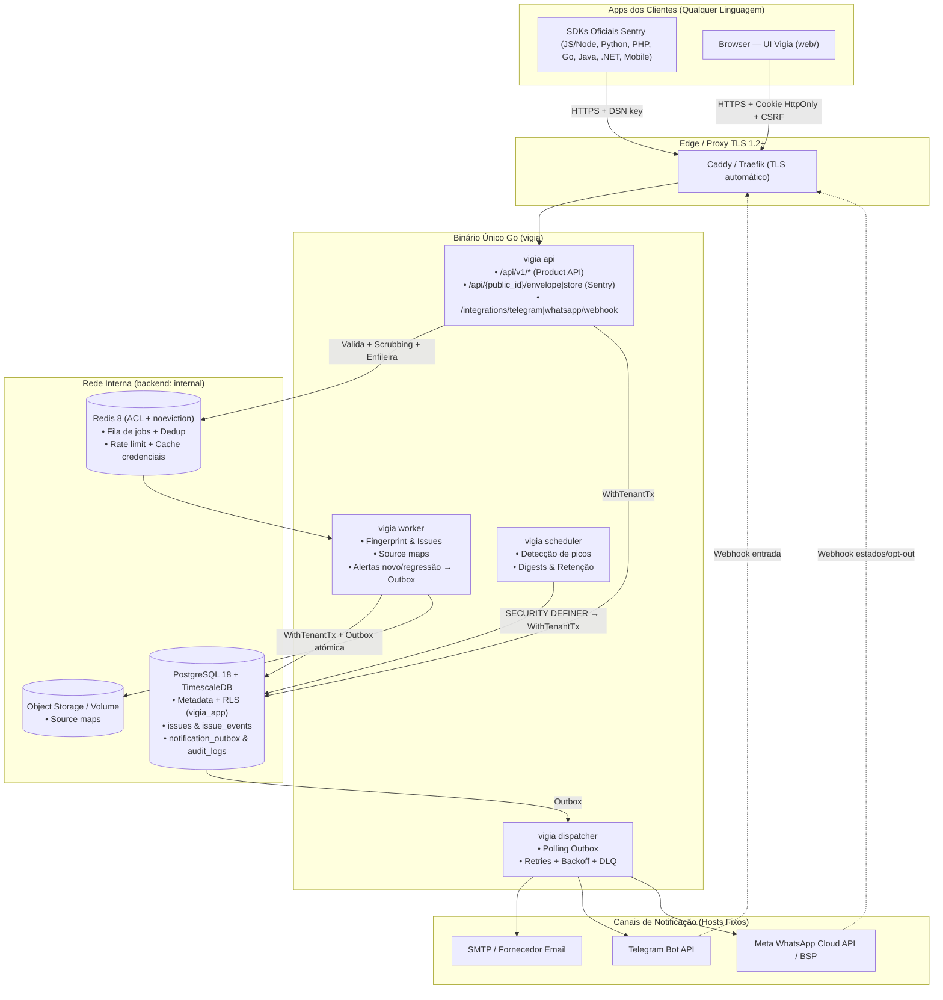
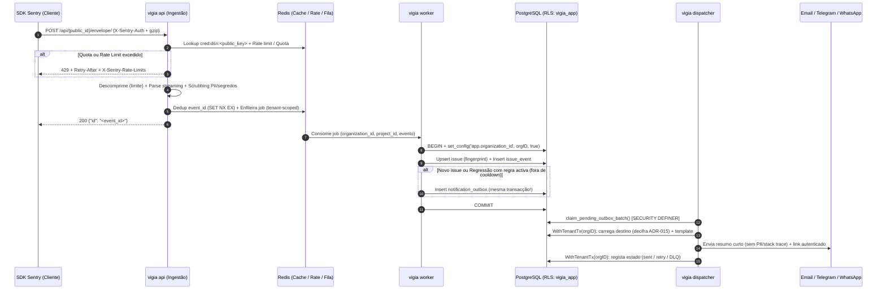
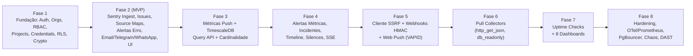

# Diagramas de Arquitectura e Fluxo — Vigia (§20.1)

- **Versão:** 1.0 (Fase 0 — Discovery; reflecte o MVP Error Tracking + evolução V1)
- **Data:** 2026-11-26
- **Responsável:** Desenvolvedor (Gemini)
- **Referências:** README §3.0, §4.1–4.5, §20.1; ADR-001, ADR-005, ADR-008, ADR-015; TASKS 0.3

---

## 1. Arquitectura do MVP (Fases 1 e 2 — Error Tracking compatível Sentry + Notificações)



---

## 2. Fluxo de Ingestão Sentry → Issue → Alerta → Notificação (MVP)



---

## 3. Fluxo de Isolamento Multi-Tenant e Roles PostgreSQL (ADR-008)

```mermaid
flowchart LR
  subgraph Migrate["Job One-Shot (vigia migrate)"]
    MigRole["Role: vigia (SUPERUSER)\nSecret: postgres_password\n• Executa migrations goose\n• Sincroniza vigia_app e vigia_definer"]
  end

  subgraph Runtime["Runtime (api, worker, scheduler, dispatcher)"]
    AppRole["Role: vigia_app\nNOSUPERUSER · NOBYPASSRLS\nSecret: postgres_app_password"]
    Definer["Role: vigia_definer\nNOLOGIN · NOSUPERUSER · BYPASSRLS\nOwner das funções SECURITY DEFINER"]
  end

  subgraph DB["PostgreSQL"]
    RLS["Tabelas Tenant-Scoped\nENABLE + FORCE ROW LEVEL SECURITY\nPolicy: organization_id = app.organization_id"]
    AppendOnly["audit_logs / incident_events\nGRANT apenas SELECT, INSERT"]
  end

  MigRole -->|DDL / Migrations| DB
  AppRole -->|1. Lookup inicial / batch cross-tenant| Definer
  Definer -->|GRANT mínimo de colunas| RLS
  AppRole -->|2. WithTenantTx: set_config(..., true)| RLS
  AppRole -->|Append-only| AppendOnly
```

---

## 4. Evolução V1 Completa (Fases 3–8)


