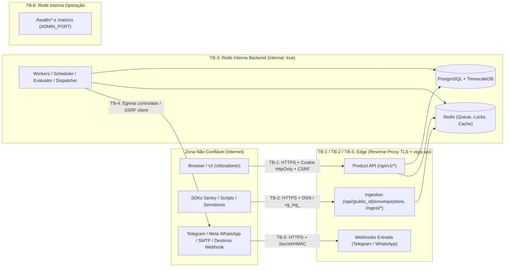

# Threat Model — Vigia

- **Versão:** 1.0 (Fase 0 — Discovery)
- **Data:** 2026-11-26
- **Responsável:** Desenvolvedor (Gemini) · Revisão: CTO (Claude)
- **Referências:** README §10, §11.1–11.9, §17.3; ADR-005, ADR-008; TASKS 0.3

> Documento vivo. Deve ser revisto **antes** de cada funcionalidade de alto risco (1.2 Auth/RBAC, 2.2 Ingestão Sentry, 2.7 Telegram/WhatsApp, 5/6 SSRF e Collectors).

---

## 1. Activos a proteger (§11.7)

| ID | Activo | Sensibilidade | Impacto de compromisso |
|---|---|---|---|
| A1 | Dados de telemetria e `issue_events` (stack traces, contexto, breadcrumbs, source maps) | Confidencial | Exposição de código proprietário, PII acidental ou vulnerabilidades dos clientes |
| A2 | Credenciais e API keys (`vg_ing_`, `vg_cli_`, `dsn`, segredos de sessão/pepper/KEK) | Segredo | Ingestão fraudulenta, leitura não autorizada ou tomada de conta |
| A3 | Identidades de utilizadores (passwords Argon2id, sessões, segredos TOTP/MFA, emails) | Segredo / PII | Account takeover, escalada para `owner`/`admin` |
| A4 | Metadata dos tenants (organizações, projectos, membros, regras, audit logs) | Confidencial | Fuga cross-tenant, violação legal (Lei n.º 22/11) |
| A5 | Segredos de canais e integrações (token bot Telegram, credenciais WhatsApp/SMTP, webhooks HMAC, credenciais de collectors) | Segredo | Abuso financeiro (WhatsApp pago), envio de phishing em nome da Yhanko, acesso a BDs de clientes |
| A6 | Contactos e subscriptions de notificação (números de telefone E.164, `chat_id` Telegram, Web Push keys) | Confidencial / PII | Spam, assédio, fuga de dados pessoais |
| A7 | Dados de incidentes, alertas e `audit_logs` | Confidencial / Integridade | Ocultação de intrusão, perda de rasto forense |
| A8 | Metadata de infraestrutura (rede interna, containers, Docker secrets, backups) | Segredo | Movimento lateral, acesso directo a PostgreSQL/Redis |
| A9 | Disponibilidade e integridade da plataforma | Operacional | Cegueira operacional dos clientes durante incidentes reais |

---

## 2. Fronteiras de confiança (Trust Boundaries)

- **TB-1 (Browser → Product API `/api/v1/*`):** tráfego autenticado por cookie `HttpOnly` + CSRF ou `vg_cli_`.
- **TB-2 (SDKs/Clientes → Ingestão):** tráfego não confiável de alto volume; chaves `dsn` são públicas em browsers.
- **TB-3 (Processos Vigia → PostgreSQL/Redis):** rede Docker `backend` (`internal: true`), sem acesso à internet nem portas públicas.
- **TB-4 (Vigia → Serviços Externos):** notificações (Telegram, WhatsApp, SMTP, Webhooks) e futuros collectors/monitors (vector principal de SSRF).
- **TB-5 (Telegram/Meta → Webhooks de Entrada):** pedidos vindos da internet que alteram estado (ligação de conta, opt-out, estados de entrega).
- **TB-6 (Operação Interna):** `/health/live`, `/health/ready` e `/metrics` (Prometheus), nunca expostos publicamente.

---

## 3. Análise STRIDE por fronteira de confiança

### TB-1 — Product API (`/api/v1/*`) e Frontend (`web/`)
| Categoria | Ameaça concreta | Controlo obrigatório | Fase |
|---|---|---|---|
| **S** (Spoofing) | Brute-force em login/MFA, roubo de sessão via XSS, session fixation, enumeração de contas | Argon2id + timing constante; cookies `HttpOnly`/`Secure`/`SameSite=Lax`; rotação de sessão; rate limit + lockout; MFA obrigatório para `owner`/`admin` (ADR-005) | 1.2 |
| **T** (Tampering) | CSRF em acções destrutivas; manipulação de `organizationId` no body; mass assignment | `Origin` + `X-CSRF-Token`; `DecodeJSON` com `DisallowUnknownFields`; `organization_id` derivado só da sessão/credencial (ADR-008) | 1.1 / 1.2 |
| **R** (Repudiation) | Utilizador nega ter alterado roles, revogado keys ou apagado projecto | `audit_logs` append-only (`SELECT`/`INSERT` apenas para `vigia_app`) com `request_id`, actor, recurso e diff sanitizado | 1.2 |
| **I** (Info Disclosure) | BOLA/IDOR cross-tenant; fuga de segredos em logs ou respostas de erro; XSS em stack traces/Markdown | `TenantID` obrigatório + PostgreSQL RLS *fail-closed* (ADR-008); `404` em acesso cross-tenant; `config.Secret`; zero stack traces em respostas; renderização como texto + CSP estrita na UI | 1.1 / 1.2 / 2.8 |
| **D** (DoS) | Slowloris, bodies gigantes, queries pesadas sem limite | Timeouts HTTP explícitos + `MaxBytesMiddleware` (`API_MAX_BODY_BYTES`); paginação por cursor obrigatória; `statement_timeout`; rate limits | 1.1 / 1.2 |
| **E** (Elevation) | `viewer`/`member` executa acções de `admin`/`owner`; `vg_ing_`/`dsn` acede a `/api/v1/*` | Middleware RBAC por permissão em cada endpoint; separação rígida por `credential_kind` + testes negativos | 1.2 / 1.3 / 2.1 |

### TB-2 — Ingestão (Sentry `/api/{public_id}/envelope|store` e Telemetria `/ingest/*`)
| Categoria | Ameaça concreta | Controlo obrigatório | Fase |
|---|---|---|---|
| **S** (Spoofing) | Uso de chave `dsn` de outro projecto ou chave revogada; spoofing de `occurredAt` | Validar `(public_key, public_id)` em conjunto; revogação imediata com invalidação Redis; guardar `received_at` do servidor e rejeitar timestamps absurdos | 2.1 / 2.2 / 3 |
| **T** (Tampering) | Envelopes malformados com `length` mentiroso; queue poisoning; injecção de HTML/markup que chega a Telegram/UI | Parser streaming com limites estritos + `go test -fuzz`; escape HTML no Telegram; renderização como texto na UI | 2.2 / 2.7 / 2.8 |
| **I** (Info Disclosure) | SDK envia passwords, cookies, cartões ou request bodies (PII) para o Vigia | Descartar `request.data`/cookies por defeito; scrubbing no servidor **antes** de enfileirar (independente de `send_default_pii`) | 2.2 / 2.3 |
| **D** (DoS) | Zip-bomb (`gzip`/`br`/`deflate`), loop infinito de erros num SDK (flood), JSON profundo, explosão de cardinalidade, *noisy neighbor* | Limite do tamanho **descomprimido**; profundidade máxima JSON; rate limit + `429` + `X-Sentry-Rate-Limits`; quotas diárias por org; filas/concorrência por tenant; allowlist de labels na Fase 3 | 2.0 / 2.2 / 3 |

### TB-3 — Rede Interna (`api`, `worker`, `scheduler`, `dispatcher`, PostgreSQL, Redis)
| Categoria | Ameaça concreta | Controlo obrigatório | Fase |
|---|---|---|---|
| **S** (Spoofing) | Acesso não autenticado a PostgreSQL ou Redis | `SCRAM-SHA-256` em Postgres; ACL obrigatória em Redis (`users.acl` em `tmpfs`); rede `backend` com `internal: true` | 0 / 1.1 |
| **T** (Tampering) | `FLUSHALL`/`CONFIG` no Redis; `UPDATE`/`DELETE` em `audit_logs`; container comprometido modifica filesystem | Comandos `@admin`, `FLUSHALL`, `FLUSHDB` bloqueados no Redis; role `vigia_app` sem `UPDATE`/`DELETE` em tabelas append-only; containers `read_only`, `cap_drop: ALL`, `no-new-privileges`, `distroless` não-root | 0 / 1.2 |
| **I** (Info Disclosure) | Fuga de Docker secrets via `docker inspect` ou logs; exposição de backups | Segredos apenas em ficheiros (`*_FILE`), nunca em env vars; `config.Secret`; envelope encryption (AES-256-GCM) para segredos em BD (ADR-015); backups encriptados com acesso restrito | 0 / 1.1 / 2.0 |

### TB-4 — Saída para Fornecedores e Destinos Externos (Notificações, Webhooks, Collectors, Monitors)
| Categoria | Ameaça concreta | Controlo obrigatório | Fase |
|---|---|---|---|
| **S / T** (Spoofing / Tampering) | Receptor de webhook não valida origem ou sofre replay; abuso de WhatsApp pago para números de terceiros | Assinatura HMAC-SHA256 (`timestamp + "." + body`) + Challenge-Echo (Fase 5); **opt-in obrigatório por código** no WhatsApp + quota mensal (Fase 2.7) | 2.7 / 5 |
| **I / E** (SSRF) | Utilizador configura URL interna (`127.0.0.1`, `169.254.169.254`, rede Docker `db:5432`/`redis:6379`) em webhook, collector ou monitor; DNS rebinding; redirect malicioso | Na Fase 2.7: hosts fixos dos fornecedores (`api.telegram.org`, API Meta/BSP, SMTP). Nas Fases 5–7: cliente `internal/platform/ssrf` obrigatório (DNS resolve + bloqueio de IPs privados/loopback/link-local/metadata/IPv6/ofuscados + ligar ao IP validado + revalidar em cada redirect) + egress policy | 2.7 / 5 / 6 / 7 |
| **I** (Info Disclosure) | Fuga de PII/stack traces completos em previews de email, Telegram ou WhatsApp | Previews contêm apenas resumo curto + link autenticado; nunca enviar stack trace completo nem PII nas notificações | 2.6 |

### TB-5 — Webhooks de Entrada (Telegram e WhatsApp)
| Categoria | Ameaça concreta | Controlo obrigatório | Fase |
|---|---|---|---|
| **S** (Spoofing) | Atacante envia payloads falsos para `/integrations/telegram/webhook` ou webhook WhatsApp para associar contas ou forjar estados | Telegram: validar `X-Telegram-Bot-Api-Secret-Token` em tempo constante. WhatsApp: validar `X-Hub-Signature-256` (HMAC-SHA256). Tokens de ligação `/start <token>` CSPRNG, uso único, expiram em 10 min | 2.7 |
| **D** (DoS) | Flood nos endpoints públicos de webhook | Limite de body estrito + rate limit por IP | 2.7 |

### TB-6 — Operação Interna e Cadeia de Fornecimento
| Categoria | Ameaça concreta | Controlo obrigatório | Fase |
|---|---|---|---|
| **I** (Info Disclosure) | Exposição pública de `/metrics` ou detalhes de `/health/ready` | Listener interno separado (`ADMIN_PORT`) não exposto no reverse proxy público; `/health/ready` nunca devolve mensagens de erro internas | 1.1 / 2.9 |
| **T / E** (Supply Chain) | Dependência comprometida em Go/npm ou imagem base alterada | `go.sum` e `pnpm-lock.yaml` fixos; imagens base fixadas por **digest SHA-256**; Dependabot com cooldown de 7 dias; `govulncheck`, `gosec`, `gitleaks`, `pnpm audit`, Trivy e SBOM no CI | 1.0 / 2.9 |

---

## 4. Mapeamento completo das ameaças da §11.7 do README

| Ameaça (README §11.7) | Fronteira | Controlo principal | Teste / Verificação |
|---|---|---|---|
| Acesso cross-tenant / BOLA | TB-1, TB-2, TB-3 | `TenantID` + RBAC + PostgreSQL RLS *fail-closed* (ADR-008) | `tests/security/` cross-tenant em todos os recursos |
| Roubo de credenciais / fuga de API key | TB-1, TB-2 | Argon2id / HMAC-SHA256 + pepper, scope mínimo, MFA, revogação imediata (ADR-005) | Testes de revogação imediata e scope negativo |
| SSRF via collectors/monitors/webhooks | TB-4 | Hosts fixos na Fase 2.7; `internal/platform/ssrf` nas Fases 5–7 + egress policy | Suite SSRF (DNS rebinding, redirects, IPs ofuscados) |
| DoS / abuso de ingestão | TB-2 | Rate limit, quotas, `MaxBytesReader`, limite descomprimido, `429`/`503` | Load test + testes zip-bomb/payload gigante |
| Abuso de queries de telemetria | TB-1 | Intervalo máximo, `step` mínimo, limite de séries/pontos, `statement_timeout` | Testes negativos de query |
| Injecção / payloads maliciosos | TB-1, TB-2, TB-5 | `sqlc` parametrizado, `DecodeJSON` estrito, `go test -fuzz` nos parsers | Fuzzing + `gosec` |
| XSS via logs/erros/Markdown | TB-1 | Renderização como texto na UI, proibição de `dangerouslySetInnerHTML`, DOMPurify em Markdown, CSP estrita | Lint frontend + testes XSS |
| CSRF (cookie-auth) | TB-1 | `SameSite=Lax` + `Origin` + `X-CSRF-Token` | Testes negativos sem header/origin |
| Replay/duplicação de eventos e webhooks | TB-2, TB-4, TB-5 | `event_id` dedup (Redis + `UNIQUE`), HMAC + janela de timestamp | Testes de replay |
| Queue poisoning | TB-2, TB-3 | Validação/scrubbing antes de enfileirar, limites de tamanho, DLQ | Testes de poison message |
| Escalada de privilégios | TB-1 | RBAC por permissão no backend, `audit_logs`, re-autenticação | Testes negativos por role |
| Segredos em logs | TB-1, TB-3 | `config.Secret`, redacção, testes de regressão | `TestSecretRedaction` + `gitleaks` |
| Explosão de cardinalidade | TB-2 | Allowlist de labels e limite de séries activas por tenant (Fase 3) | Testes de quota/cardinalidade |
| Compromisso de worker | TB-3, TB-4 | `distroless` não-root, `read_only`, `cap_drop: ALL`, `vigia_app` mínimo, egress | `docker compose config` + revisão |
| Fuga em notificações | TB-4 | Previews sem PII/stack trace completo; link autenticado | Testes de template/scrubbing |
| Cadeia de fornecimento | TB-6 | Digests, lockfiles, Dependabot cooldown 7d, `govulncheck`, Trivy, SBOM | CI `security` job |
| Backup exposto | TB-3 | Backups encriptados, acesso restrito, restore ensaiado | Runbook + teste de restore |

---

## 5. Riscos residuais conhecidos na Fase 0

1. **Abuso de chaves `dsn` públicas em browsers:** como a chave é visível no cliente, um actor externo pode tentar gerar ruído ou consumir a quota de um projecto. Mitigado por `allowed_origins`, rate limiting agressivo, inbound filters e revogação/rotação rápida; não eliminável a 100% por natureza do protocolo web.
2. **Garantia fim-a-fim de notificações externas:** email, Telegram e WhatsApp dependem de terceiros; o Vigia garante entrega até ao fornecedor com retries/DLQ e regista o estado de entrega, mas não controla a recepção no dispositivo final (§7.7).
3. **Protecção de dados pessoais (Lei n.º 22/11):** requer enquadramento jurídico (termos, política de privacidade e workflow de eliminação) antes do go-live da Fase 2.9 (acção 👔 CEO).
